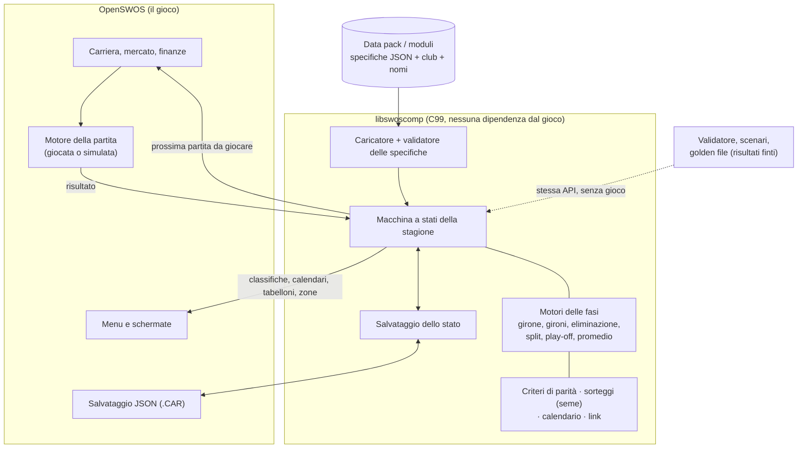
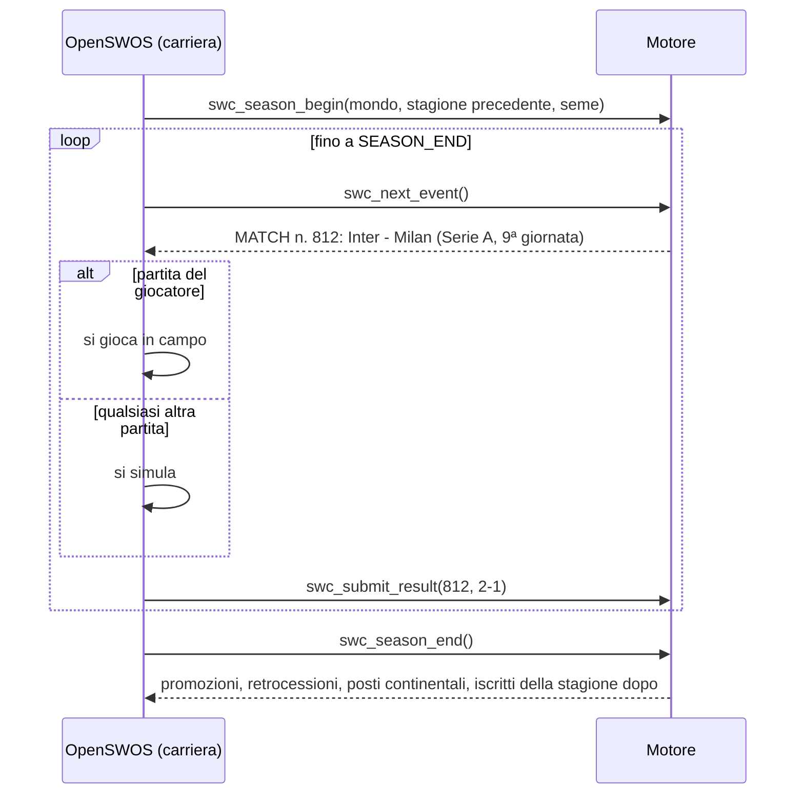

# Un motore deterministico delle competizioni per OpenSWOS: proposta di convergenza

> Un *motore delle competizioni* separato dal gioco (libreria C99 senza dipendenze, compilabile anche per Amiga), guidato da **specifiche dichiarative** (JSON validato da JSON Schema) che descrivono ogni competizione come una sequenza di *fasi*, collegate da *link* (qualificazioni, promozioni, retrocessioni, posti continentali). Il motore non gioca le partite: chiede i risultati al gioco con una callback, così la logica dei formati si può testare da sola. Tutto è **deterministico**: stessa specifica + stesso seme + stessi risultati = stessa stagione, verificata da *golden file*. I formati del 1996 diventano specifiche "originali" (il gioco classico resta identico), i formati del Mod diventano *data pack*.

Stato: proposta da discutere, 25/10/2026. Accompagna "Le competizioni oggi" (stato attuale) e "Linee guida per lo sviluppo con AI" (come si lavorerebbe).

## 1. Obiettivi e non obiettivi

**Obiettivi**

1. Ogni campionato, coppa o competizione a più fasi di qualsiasi nazione, stagione o epoca esprimibile come **dati**.
2. **Determinismo**: una stagione è una funzione pura di (specifiche, seme, risultati delle partite).
3. **Testabile senza il gioco**: il motore gira senza interfaccia con un fornitore di risultati finto (stub).
4. **API e schema documentati**, versionati, con strumenti di validazione: le sessioni AI scrivono codice contro questo contratto, mai contro offset di byte.
5. **Il gioco classico resta il gioco classico**: le competizioni del 1996 girano invariate (con il codice fedele o con specifiche dimostrate equivalenti dai golden test).

**Non obiettivi**

- Il motore delle partite, i trasferimenti, le finanze, i menu. Il motore espone ciò che serve all'interfaccia (classifiche, calendari, tabelloni, etichette di zona) ma non disegna nulla.
- Sostituire il port fedele di OpenSWOS. Il nuovo motore si *aggiunge accanto*.

## 2. Opzioni di convergenza

| Opzione | Cosa significa | Pro | Contro |
|---|---|---|---|
| **A. Dati del Mod sui record del 1996** | Convertire i mondi del Mod nei record JSON esistenti di OpenSWOS e aggiungere un modulo C per ogni formato mancante (come per la Copa Libertadores) | Primo passo più piccolo; riusa tutto | Ogni formato nuovo = C nuovo nel cuore del gioco; restano i limiti di 24 squadre, play-off solo inglesi, 16/32/32 e id di un byte; ripete la storia del Mod |
| **B. Libreria condivisa del motore** | Una libreria autonoma (`libswoscomp`, C99) con modello delle specifiche, calendari, classifiche, sorteggi, link; OpenSWOS la chiama per le carriere "estese" | I formati diventano dati; testabile da sola; usabile da altri progetti (editor, strumenti del Mod, visualizzatore web) | Vero lavoro di progettazione; integrazione con carriera e trasferimenti |
| **C. Formato data pack** | Un pacchetto versionato (`*.swospack`: specifiche + squadre + nomi + calendari + file di licenza) | Distribuzione pulita; separa le licenze dei dati da quelle del codice | Serve B (o A) per girare |

**Raccomandazione: B + C**, tenendo la lezione di A: il percorso fedele resta il predefinito e le competizioni del 1996 si riscrivono come specifiche solo quando un golden test dimostra che il motore le riproduce. Il Mod diventa così un insieme di data pack più, dove una regola è davvero nuova, una funzione del motore revisionata e con i suoi test.

## 3. Architettura



Regole di progetto (derivano da quelle di OpenSWOS in `.claude/CLAUDE.md`):

- Solo tipi interi a larghezza fissa, niente virgola mobile in ciò che decide un risultato (target Amiga, determinismo bit per bit). I rapporti come il promedio si confrontano con prodotti incrociati tra interi.
- Niente variabili globali: ogni chiamata riceve un `SwcSeason *`. Niente puntatori nello stato salvato, solo id.
- Il motore non chiama mai il motore delle partite. Chiede risultati; interattivo o simulato è affare del gioco.
- Ogni regola che il motore applica ha un nome nella specifica. Nessun percorso di codice nascosto per una nazione.

## 4. Il modello delle specifiche

Un **mondo** (un universo di carriera) contiene **competizioni**; una competizione è una lista ordinata di **fasi**; le fasi producono **classifiche**; i **link** spostano i club tra fasi, competizioni e stagioni. Formato canonico: JSON, validato da `schema/competition.schema.json` (JSON Schema 2020-12). Gli strumenti accettano anche YAML per comodità di scrittura e lo convertono in JSON prima della validazione; il motore legge solo JSON. Gli esempi qui sotto sono in YAML per leggibilità.

### 4.1 Identificativi

- Ogni oggetto ha un id testuale stabile con spazio dei nomi: `ita.serie-c`, `ita.serie-c.girone-a`, `uefa.ucl.league-phase`. Il motore li converte in interi al caricamento; i salvataggi conservano le stringhe.
- I club si indicano con un **id di club** stabile (`club:ita.inter`), mai con file/ordinale. L'`uuid` delle squadre di OpenSWOS nomina una *rosa fissa* (`docs/TEAM_IDS.md`: giocatori o abilità cambiati = uuid nuovo), quindi identifica una versione della rosa, non un club attraverso le stagioni. Un pack associa id di club e uuid della rosa per stagione; i dati delle squadre usano il formato JSON già esistente (`docs/DATA_JSON.md` §4), così il caricatore del gioco legge le rose dei pack senza modifiche.

### 4.2 Competizione

```yaml
id: ita.serie-a
kind: league            # league | cup | league-cup | supercup | continental | playoff | tournament
country: ITA            # FIFA/IOC-style code; continental bodies: UEFA, CONMEBOL ...
level: 1                # pyramid level (leagues only)
season_span: cross-year # cross-year (2026-27) | calendar-year (2026)
names: { en: "Serie A", it: "Serie A" }   # see §10
participants: { count: 20, source: link }  # who enters: link | fixed list | draw from pool
points: { win: 3, draw: 1, loss: 0 }
stages: [ ... ]         # §4.3
outcomes: [ ... ]       # §4.6: titles, promotion, relegation, places
calendar: { ... }       # §4.7
```

### 4.3 Tipi di fase

| `type` | Parametri | Produce |
|---|---|---|
| `round_robin` (girone all'italiana) | `legs` (1..4), `schedule: generated \| fixed`, `home_balance` | una classifica |
| `groups` (gironi) | `groups` (numero e dimensioni, anche diverse), `allocation: draw \| fixed \| geographic`, `legs`, opzioni del girone | classifica per girone + eventuale classifica tra gironi (`best_of`: es. migliori terze) |
| `league_phase` (sistema svizzero) | `pots`, `opponents_per_pot`, `home_away_split`, `constraints` | una classifica |
| `knockout` (eliminazione diretta) | `rounds[]`, ognuno con `legs` (1/2), `decider` (vedi 4.4), `home: draw \| better_placed \| better_placed_second_leg \| neutral \| fixed`, `byes`, `pairing: draw \| seeded \| bracket \| fixed` | vincenti / perdenti per turno, classifica finale |
| `playoff` (play-off / play-out) | come knockout + `entrants: [posizioni]`, `skip_if: {points_gap_ge: 8}` | vincente/i, perdente/i |
| `split` (poule) | `after_stage`, `sections: [{positions: 1-6, legs: 1}, ...]`, `carry: points \| halve_points \| none` | classifiche per sezione, classifica finale unita |
| `aggregate_table` (classifica aggregata) | `of: [id fasi]`, `mode: sum \| average` | una classifica (annuale Apertura+Clausura) |
| `average_table` (promedio) | `of: [id competizioni]`, `seasons: 3`, `metric: points_per_match`, `newcomer: current_only \| fill_with` | una classifica |
| `single_match` (partita secca) | `home`, `decider` | vincente (supercoppe, Campeón de Campeones) |

Le fasi si giocano in ordine; i partecipanti di una fase (`entrants`) sono riferimenti a classifiche come `stage:apertura.table#1-8` o `link:qualified-from(ita.coppa-italia)`.

**Apertura/Clausura** non è un tipo speciale: sono due fasi `round_robin` (ognuna con `resets: [points, stats]`), ciascuna seguita dalla sua `knockout` (liguilla), più una `aggregate_table` per la classifica annuale.

### 4.4 Criteri di parità e modi di decidere un turno

Le classifiche usano una lista ordinata di criteri con nome; il motore li applica in ordine, e un criterio `head_to_head` apre una mini-classifica tra le squadre ancora a pari (ricorsiva, come prevedono le regole UEFA/FIFA):

```yaml
tiebreakers: [points, head_to_head_points, head_to_head_goal_difference, goal_difference,
              goals_for, wins, away_goals_for, fair_play, draw_lots]
```

Criteri disponibili: `points`, `goal_difference`, `goals_for`, `goals_against`, `wins`, `away_wins`, `away_goals_for`, `head_to_head_{points,goal_difference,goals_for,away_goals}`, `opponents_points`, `opponents_goal_difference`, `opponents_goals_for`, `fair_play`, `coefficient`, `previous_stage_rank`, `play_off_match` (la parità si risolve con uno spareggio), `draw_lots` (sorteggio con il generatore a seme), `name` (solo per `faithful_1996`, l'ordine originale: punti, differenza reti, gol fatti, nome).

I **modi di decidere** un turno a eliminazione sono la regola del Mod "un'unica impostazione di spareggio per turno" (CONVENTIONS 10) resa esplicita: `aggregate` (somma dei gol), poi la lista ordinata di `away_goals`, `extra_time`, `penalties`, `better_placed`, `replay`. Esempio: `decider: [aggregate, extra_time, penalties]`.

### 4.5 Sorteggi

```yaml
draw:
  method: pots          # random | pots | seeded_bracket | fixed | geographic
  pots: { by: coefficient, size: 9 }
  constraints:
    - same_country_not_allowed: true        # country protection
    - max_per_country_per_group: 1
    - separate: [[CLUB_A, CLUB_B]]          # political separations
  rng_purpose: "uefa.ucl.league-phase.draw" # names the RNG substream, §6
```

I sorteggi con vincoli usano una ricerca deterministica con ritorno all'indietro (l'ordine dei candidati è il rimescolamento a seme; vince il primo abbinamento valido), quindi un sorteggio è riproducibile e termina sempre, oppure la validazione lo segnala come `unsatisfiable`.

### 4.6 Esiti e link

Gli esiti dicono cosa *significa* una posizione in classifica; i link dicono *dove va*:

```yaml
outcomes:
  - { positions: 1,     tag: champion }
  - { positions: 1-4,   tag: continental, to: uefa.ucl,  via: access-list }
  - { positions: 18-20, tag: relegated,   to: ita.serie-b, season: next }
```

Le etichette guidano sia il passaggio di stagione sia l'interfaccia (i colori di zona e la legenda del Mod: `zone: CL | EL | CONF | PROM | P.OFF | P.OUT | RETR`). I posti possono essere **fissi** (`to: X`) o **calcolati** (`via: access-list`): un'access list è anch'essa un dato (posizione della federazione -> posti) e i coefficienti sono una specifica di calcolo a parte (`coefficients.yaml`: punti per vittoria/pareggio, bonus per turno, finestra di 5 stagioni). I posti non usati scalano secondo una regola dichiarata (`cascade: next_in_league | to_cup_runner_up | to_association_rank`).

La promozione tra gironi paralleli (Serie C/D) usa `assign: geographic` con una mappa club -> area nel pack.

### 4.7 Calendario

```yaml
calendar:
  window: { start: 2026-08-22, end: 2027-05-30 }
  matchdays: generated            # or: fixed (file: fixtures/ita-serie-a-2026-27.json)
  rest_rule: { min_days: 2 }
  pause: [ { from: 2026-12-28, to: 2027-01-03 } ]
```

Le date reali sono di prima classe; il motore le proietta sulla griglia settimanale del gioco. I calendari `fixed` (quelli veri) servono per la prima stagione; quelle successive usano il generatore (metodo del cerchio, corretto anche con squadre dispari, al massimo N partite consecutive in casa o in trasferta: le regole di `oddtables.py` del Mod).

Il sistema dei moduli (cartelle, manifesti, porte) e l'elenco completo delle primitive sono in "Moduli e catalogo delle regole"; i test in "Strategia di test".

## 5. API (C99)

Come leggere il C qui sotto, se non l'hai mai scritto:

- ogni riga che finisce con `;` è la **dichiarazione di una funzione**: dice come si chiama, cosa riceve e cosa restituisce, non come funziona dentro;
- la parola prima del nome è ciò che la funzione **restituisce**: qui sempre `SwcStatus`, cioè "tutto bene" oppure un codice d'errore;
- tra parentesi ci sono gli **ingressi**, separati da virgole, ognuno come *tipo nome* (es. `uint64_t seed` = un numero intero senza segno a 64 bit chiamato `seed`);
- `*` dopo un tipo vuol dire "un **riferimento** a un dato di quel tipo" (la funzione lavora sul dato originale, non su una copia); `**out` è un riferimento a un riferimento, il modo del C per dire "qui ti restituisco un oggetto nuovo";
- `const` vuol dire che la funzione **legge** quel dato ma non lo modifica;
- `Swc...` sono i tipi del motore (`SwcWorld` = un mondo caricato, `SwcSeason` = una stagione in corso, `SwcResult` = il risultato di una partita...); tutto ciò che sta tra `/*` e `*/` è un commento per chi legge.

```c
/* 1. CARICARE E CONTROLLARE UN MONDO */

/* Legge il testo JSON di un mondo (json = il testo, len = la sua lunghezza in byte)
 * e, se è valido, restituisce in 'out' il mondo caricato; gli errori finiscono in 'diag'.
 * Non tocca nessun dato del gioco. */
SwcStatus swc_world_load(const char *json, size_t len, SwcWorld **out, SwcDiag *diag);

/* Controlli statici su un mondo già caricato (porte, conteggi, piramide...). */
SwcStatus swc_world_validate(const SwcWorld *w, SwcDiag *diag);

/* 2. INIZIARE UNA STAGIONE */

/* Crea la stagione nuova a partire dal mondo 'w', dalla stagione precedente 'prev'
 * (vuota alla prima stagione) e da un numero 'seed', il seme: con lo stesso seme
 * i sorteggi vengono sempre uguali. La stagione creata torna in 'out'. */
SwcStatus swc_season_begin(const SwcWorld *w, const SwcSeason *prev,
                           uint64_t seed, SwcSeason **out);

/* 3. IL CICLO DELLA STAGIONE: il motore dice cosa succede, il gioco risponde */

/* Chiede al motore il prossimo evento e lo scrive in 'ev'. Gli eventi sono:
 * MATCH (gioca questa partita), DRAW_DONE (sorteggio fatto),
 * STAGE_END (fase finita), SEASON_END (stagione finita). */
SwcStatus swc_next_event(SwcSeason *s, SwcEvent *ev);

/* Comunica al motore il risultato della partita numero 'match_id'.
 * 'r' contiene: gol al 90', gol dopo i supplementari, rigori, cartellini
 * (per il fair play) ed eventuali sconfitte a tavolino. */
SwcStatus swc_submit_result(SwcSeason *s, uint32_t match_id, const SwcResult *r);

/* 4. DOMANDE PER LE SCHERMATE (sola lettura) */

/* La classifica di una fase ('stage_id', es. "ita.serie-a.table"),
 * per il girone numero 'group'; il risultato va in 'out'. */
SwcStatus swc_table(const SwcSeason *s, const char *stage_id, int group, SwcTableView *out);

/* Il calendario di una competizione ('comp_id', es. "ita.coppa-italia"). */
SwcStatus swc_fixtures(const SwcSeason *s, const char *comp_id, SwcFixtureList *out);

/* Il tabellone di una fase a eliminazione. */
SwcStatus swc_bracket(const SwcSeason *s, const char *stage_id, SwcBracketView *out);

/* Le zone colorate e la legenda di una classifica (CL, EL, PROM, RETR...). */
SwcStatus swc_zones(const SwcSeason *s, const char *stage_id, SwcZoneList *out);

/* 5. FINE STAGIONE */

/* Risolve tutti i link (promozioni, retrocessioni, posti continentali,
 * passaggi tra coppe) e scrive in 'out' chi entra dove la stagione prossima. */
SwcStatus swc_season_end(SwcSeason *s, SwcTransition *out);

/* 6. SALVARE E CARICARE (§7) */

/* Scrive lo stato della stagione nel salvataggio tramite lo "scrittore" 'w'. */
SwcStatus swc_season_save(const SwcSeason *s, SwcWriter *w);

/* Rilegge una stagione salvata dal "lettore" 'r', per il mondo 'w'. */
SwcStatus swc_season_load(const SwcWorld *w, SwcReader *r, SwcSeason **out);
```

Il ciclo di stagione del gioco diventa: chiedi `swc_next_event`, gioca o simula la partita indicata, `swc_submit_result`, ripeti. La partita del giocatore e quelle simulate seguono lo stesso percorso, così un errore negli spareggi non può nascondersi nelle "altre divisioni".



## 6. Determinismo

- **Un solo algoritmo di generazione casuale, specificato bit per bit** (es. PCG32 o xoshiro128**, solo interi a 32 bit), mai `rand()`, mai l'orologio dentro il motore.
- **Flussi separati per scopo**: ogni decisione casuale usa un flusso derivato da `hash(seme, stagione, rng_purpose)`. Aggiungere una competizione non cambia il sorteggio di un'altra, e così i golden file restano stabili e le differenze leggibili.
- Il generatore delle partite del gioco (`Rand`/`Rand2`) non si tocca; i risultati simulati arrivano dal gioco. Per i test un **fornitore finto** ricava i risultati da `hash(id_partita, seme)` (con distribuzioni di gol realistiche), così un mondo intero gira in millisecondi senza interfaccia.
- L'ordine di iterazione è sempre quello dichiarato o per id, mai per puntatore o per tabella hash.

**Harness con golden file**: `swc-sim --world W.json --seed 42 --seasons 3 --results stub > out.json`; l'integrazione continua confronta `out.json` (ogni classifica, tabellone, sorteggio, link) con `tests/golden/W-42.json`. Una modifica che cambia un golden file deve dire perché nel suo commit. Lo stesso harness dimostra le specifiche del 1996: si fanno girare il codice fedele e il motore con lo stesso seme e gli stessi risultati e si confronta.

## 7. Salvataggi e versioni

- Lo stato della stagione si salva come campi JSON con nome (la regola di OpenSWOS: niente indirizzi, niente dump grezzi), dentro il `.CAR` JSON esistente come oggetto `"competitions_v1"`.
- Tre versioni separate: **schema** delle specifiche, **stato** dei salvataggi, **pack** dei dati. Ogni caricamento esegue le migrazioni dichiarate (`migrations/state-1-to-2.c`); un salvataggio non cambia mai significato in silenzio.
- Un salvataggio registra id, versione e hash del pack con cui è stato fatto; caricarlo con un pack diverso viene rifiutato con un messaggio chiaro (il Mod l'ha imparato a sue spese: un salvataggio di una versione dati rigiocato su un'altra sembra un blocco del gioco).

## 8. Strumenti di validazione

- `swc-validate`: JSON Schema + controlli di senso: i partecipanti tornano, ogni destinazione di link esiste, le dimensioni dei gironi stanno, un sorteggio con vincoli è risolvibile, ogni posizione di un esito esiste, i nomi esistono in ogni lingua dichiarata e stanno nella larghezza dell'interfaccia (la regola del Mod "nessun carattere estraneo, ogni titolo entra nella sua barra").
- `swc-explain`: descrive una competizione in linguaggio normale (EN/IT/FR/DE) generandola dalla specifica: le pagine FORMAT del Mod e il suo elenco "Ogni nazione, ogni competizione" diventano un prodotto dei dati invece di un testo parallelo.
- `swc-sim`: stagioni senza interfaccia (golden file, statistiche, controlli di forza rispetto alle classifiche vere).

## 9. Quattro formati reali nella specifica

Sono esempi: i regolamenti esatti 2026-27 vanno verificati prima di inserire i dati (la regola del Mod "formati reali esatti" vale per i dati, non per questo documento).

### 9.1 Liga MX: Apertura / Clausura, Play-In, Liguilla, Campeón de Campeones

(Nel Mondo 2026-27 del Mod la Liga MX oggi è un girone unico da 34 giornate; questa specifica mostra il formato reale che il motore permetterebbe.)

```yaml
id: mex.liga-mx
kind: league
country: MEX
season_span: cross-year
participants: { count: 18, source: link }
points: { win: 3, draw: 1, loss: 0 }
tiebreakers: [points, goal_difference, goals_for, head_to_head_points, away_goals_for, fair_play, draw_lots]
stages:
  - { id: apertura, type: round_robin, legs: 1, schedule: generated }
  - id: apertura-playin
    type: playoff
    entrants: [apertura#7, apertura#8, apertura#9, apertura#10]
    rounds:
      - { pairs: ["#7-#8", "#9-#10"], legs: 1, home: better_placed, decider: [penalties] }
      - { pairs: ["loser(1.1)-winner(1.2)"], legs: 1, home: better_placed, decider: [penalties] }
    produces: { seed7: "winner(1.1)", seed8: "winner(2.1)" }
  - id: apertura-liguilla
    type: knockout
    entrants: [apertura#1-6, apertura-playin.seed7, apertura-playin.seed8]
    pairing: seeded          # 1v8, 2v7, 3v6, 4v5, reseeded each round
    rounds:
      - { name: quarter-finals, legs: 2, home: better_placed_second_leg, decider: [aggregate, better_placed] }
      - { name: semi-finals,    legs: 2, home: better_placed_second_leg, decider: [aggregate, better_placed] }
      - { name: final,          legs: 2, home: better_placed_second_leg, decider: [aggregate, extra_time, penalties] }
  - { id: clausura, type: round_robin, legs: 1, schedule: generated, resets: [points, stats] }
  - { id: clausura-playin,   like: apertura-playin,   entrants_from: clausura }
  - { id: clausura-liguilla, like: apertura-liguilla, entrants_from: [clausura, clausura-playin] }
  - { id: annual, type: aggregate_table, of: [apertura, clausura], mode: sum }
  - id: campeon-de-campeones
    type: single_match
    entrants: [apertura-liguilla.winner, clausura-liguilla.winner]
    home: neutral
    decider: [extra_time, penalties]
    skip_if: same_club
outcomes:
  - { from: apertura-liguilla, positions: 1, tag: champion, title: "Apertura" }
  - { from: clausura-liguilla, positions: 1, tag: champion, title: "Clausura" }
  - { from: annual, tag: none }                 # no relegation (suspended)
```

### 9.2 Serie C: tre gironi paralleli, promozione, play-off, play-out

```yaml
id: ita.serie-c
kind: league
country: ITA
level: 3
participants: { count: 60, source: link }
stages:
  - id: gironi
    type: groups
    groups: [ { id: A, size: 20 }, { id: B, size: 20 }, { id: C, size: 20 } ]
    allocation: geographic            # club -> area map in the pack
    legs: 2
    tiebreakers: [points, head_to_head_points, head_to_head_goal_difference, goal_difference, goals_for, draw_lots]
  - id: playout
    type: playoff
    per_group: true
    entrants: ["#16", "#17", "#18", "#19"]
    rounds:
      - pairs: ["#16-#19", "#17-#18"]
        legs: 2
        home: better_placed_second_leg
        decider: [aggregate, better_placed]
        skip_if: { points_gap_ge: 8, then: lower_relegated }
  - id: playoff
    type: playoff
    entrants: [gironi.A#2-10, gironi.B#2-10, gironi.C#2-10, link:winner(ita.coppa-italia-serie-c)]
    rounds:                           # simplified: the real 28-club bracket is in the pack
      - { name: group-phase-1, legs: 1, home: better_placed, decider: [better_placed], per_group: true }
      - { name: group-phase-2, legs: 1, home: better_placed, decider: [better_placed], per_group: true }
      - { name: national-1,    legs: 2, home: draw, decider: [aggregate, better_placed] }
      - { name: national-qf,   legs: 2, home: draw, decider: [aggregate, better_placed] }
      - { name: semi-finals,   legs: 2, home: draw, decider: [aggregate, extra_time, penalties] }
      - { name: final,         legs: 2, home: draw, decider: [aggregate, extra_time, penalties] }
outcomes:
  - { from: gironi, positions: 1, per_group: true, tag: promoted, to: ita.serie-b, zone: PROM }
  - { from: playoff, positions: 1, tag: promoted, to: ita.serie-b, zone: P.OFF }
  - { from: gironi, positions: 20, per_group: true, tag: relegated, to: ita.serie-d, zone: RETR }
  - { from: playout, losers: true, tag: relegated, to: ita.serie-d, zone: P.OUT }
```

### 9.3 UEFA Champions League: league phase

```yaml
id: uefa.ucl
kind: continental
country: UEFA
participants: { count: 36, source: access-list, qualifying: uefa.ucl.qualifying }
stages:
  - id: league-phase
    type: league_phase
    pots: { count: 4, size: 9, by: coefficient, holder_in_pot: 1 }
    opponents_per_pot: 2          # one home, one away
    constraints: [ { same_country_not_allowed: true }, { max_opponents_same_country: 2 } ]
    tiebreakers: [points, goal_difference, goals_for, away_goals_for, wins, away_wins,
                  opponents_points, opponents_goal_difference, opponents_goals_for,
                  fair_play, coefficient]
    rng_purpose: uefa.ucl.draw.league-phase
  - id: ko-playoff
    type: knockout
    entrants: [league-phase#9-24]
    pairing: { seeded: "9-16 vs 17-24", by_bracket: true }
    rounds: [ { legs: 2, home: better_placed_second_leg, decider: [aggregate, extra_time, penalties] } ]
  - id: knockout
    type: knockout
    entrants: [league-phase#1-8, ko-playoff.winners]
    pairing: bracket               # fixed bracket from league-phase positions
    rounds:
      - { name: round-of-16,    legs: 2, home: better_placed_second_leg, decider: [aggregate, extra_time, penalties] }
      - { name: quarter-finals, legs: 2, home: draw, decider: [aggregate, extra_time, penalties] }
      - { name: semi-finals,    legs: 2, home: draw, decider: [aggregate, extra_time, penalties] }
      - { name: final,          legs: 1, home: neutral, decider: [extra_time, penalties] }
outcomes:
  - { from: knockout, positions: 1, tag: champion }
  - { from: league-phase, positions: 25-36, tag: eliminated }
links:
  - { winner_of: uefa.ucl, to: uefa.ucl, season: next, slot: title_holder }
  - { winner_of: uefa.ucl, to: uefa.super-cup, season: next }
```

### 9.4 Argentina: Liga Profesional a zone, classifica annuale e promedio

```yaml
id: arg.liga-profesional
kind: league
country: ARG
season_span: calendar-year
participants: { count: 30, source: link }
stages:
  - id: apertura
    type: groups
    groups: [ { id: A, size: 15 }, { id: B, size: 15 } ]
    allocation: fixed
    schedule: fixed                       # the real fixture list incl. interzonal matchdays
    matchdays: 16
  - id: apertura-final
    type: knockout
    entrants: { cross: "A#1-8 vs B#8-1" }
    rounds:
      - { name: round-of-16,    legs: 1, home: better_placed, decider: [extra_time, penalties] }
      - { name: quarter-finals, legs: 1, home: better_placed, decider: [extra_time, penalties] }
      - { name: semi-finals,    legs: 1, home: better_placed, decider: [extra_time, penalties] }
      - { name: final,          legs: 1, home: neutral,       decider: [extra_time, penalties] }
  - { id: clausura,       like: apertura,       resets: [points, stats] }
  - { id: clausura-final, like: apertura-final, entrants_from: clausura }
  - { id: annual, type: aggregate_table, of: [apertura, clausura], mode: sum }
  - id: promedio
    type: average_table
    of: [arg.liga-profesional]
    seasons: 3
    metric: points_per_match              # compared as cross-multiplied integers
    newcomer: current_only
    tiebreakers: [metric, annual_points, goal_difference, play_off_match]
  - id: trofeo-de-campeones
    type: single_match
    entrants: [apertura-final.winner, clausura-final.winner]
    home: neutral
    decider: [extra_time, penalties]
    skip_if: same_club
outcomes:
  - { from: promedio, positions: 30, tag: relegated, to: arg.primera-nacional, zone: RETR }
  - { from: annual, tag: continental, via: conmebol-access-list }   # positions come from the access list
```

## 10. Localizzazione

- Nomi e titoli sono stringhe con chiave e valori per lingua (`en`, `it`, `fr`, `de`, `es`, `pt` …) più forme `short` con una larghezza massima dichiarata (l'interfaccia del 1996 ha limiti rigidi: il Mod misura titoli di 35 byte ed etichette di calendario di 70 pixel).
- La grafia del gioco in ogni lingua per nazioni e menu (regola del Mod) è un dato, non codice.
- I testi generati (spiegazioni dei formati, nomi dei turni: "round of 16", "ottavi di finale") vengono da modelli per lingua nel pack, così `swc-explain` e il gioco dicono la stessa cosa.

## 11. Piano di migrazione

| Fase | Prodotto | Criterio di uscita |
|---|---|---|
| 0 | Golden test di stagione per l'OpenSWOS *attuale* (carriera con seme fisso, 2 stagioni, dump JSON di classifiche, promozioni, posti europei) | gira nell'integrazione continua, stabile tra le build SDL |
| 1 | Schema v1 + validatore + `swc-explain`; le competizioni del 1996 scritte come specifiche | validatore verde su tutte |
| 2 | Cuore del motore: girone all'italiana, eliminazione diretta, criteri di parità, link; fornitore finto; golden file | piramide inglese 1996 + FA Cup riproducono esattamente la fase 0 |
| 3 | Integrazione dietro un interruttore: la "carriera estesa" usa il motore; carriere classiche intatte | golden della fase 0 invariati |
| 4 | Gironi, play-off/play-out, split, classifiche aggregate e promedio; sorteggi con vincoli | i quattro esempi del §9 simulano 3 stagioni, golden file nel repository |
| 5 | Livello continentale: access list, coefficienti, preliminari, league phase | il modello UEFA del Mod (riferimento Python `uefaq`) e il motore coincidono su una stagione congelata |
| 6 | Data pack: il Mondo 2026-27 convertito dai dati del Mod | ogni competizione di `world-2026-27-competitions.md` si valida e si simula |

Ogni fase è una serie di piccole pull request; l'ordine permette a OpenSWOS di fermarsi dopo qualsiasi fase con qualcosa di utile (già la fase 0 da sola è una rete di sicurezza che oggi manca).

## 12. Domande sulle licenze per Davide (senza conclusioni legali)

1. **Codice.** OpenSWOS è GPL-3.0-or-later. Un motore sviluppato dentro OpenSWOS, o derivato dal suo codice, sarebbe GPL. Vuoi il motore GPL, o una libreria scritta a parte con licenza permissiva (MIT/BSD/LGPL) usabile da altri strumenti? Una libreria scritta a parte non può copiare codice di OpenSWOS; la regola del Mod oggi è "mai copiare codice di OpenSWOS nel Mod".
2. **Il codice del Mod** (strumenti Python, stub nasm, moduli C): con che licenza è oggi, e portarne la *logica* in OpenSWOS sarebbe una decisione di rilicenza che solo tu puoi prendere? I contributi di altre persone (rose di Angelo, il database 1984-85 di DaniSwos) richiedono il consenso degli autori per una licenza o un canale di distribuzione nuovi.
3. **Dati.** Rose derivate da Transfermarkt (loro condizioni d'uso / diritti sulle banche dati), valutazioni derivate dai dati EA FC, maglie dagli infobox di Wikipedia (CC BY-SA: attribuzione e condivisione allo stesso modo si applicherebbero ai dati derivati). Ogni fonte può stare nel repository di un progetto GPL, o i pack vanno distribuiti a parte con la loro licenza e il file dei crediti?
4. **SWOS stesso.** Entrambi i progetti richiedono la copia del gioco del giocatore; asset e nomi originali restano dei titolari dei diritti. Pack che contengono solo dati nuovi (nessun file originale) sarebbero accettabili per la politica del maintainer di OpenSWOS (il repository ha smesso di contenere i dati originali il 19/10/2026)?
5. **Nomi e marchi.** Nomi di competizioni e club, maglie simili ai loghi: la pratica attuale del Mod (nomi come sui giornali, niente loghi) resta una regola dei pack?

Un breve accordo scritto con Playaveli / Ben Baker sui punti 1 e 3 prima di scrivere codice eviterebbe lavoro rifatto.
