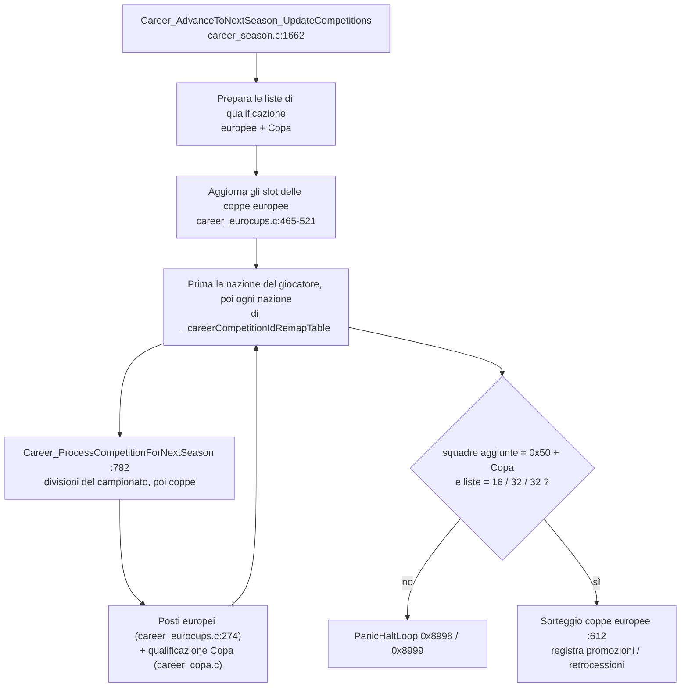

# Le competizioni in OpenSWOS, nel DOS 96/97 originale e nel Mod SWOS 96/97

> OpenSWOS rappresenta campionati e coppe con gli stessi record dell'originale SWOS, oggi caricati da JSON ma con la stessa forma del 1996. I *dati* (squadre, divisioni, promozioni, gambe/supplementari/rigori per turno, gironi) sono già modificabili; la *logica* dei formati è nel codice C tradotto 1:1 dall'assembly Amiga: calendari da tabelle fisse di coppie (2-24 squadre), classifica a criteri fissi (punti, differenza reti, gol fatti, nome), promozioni e retrocessioni a conteggi, play-off solo per l'Inghilterra, qualificazioni europee a 16 + 32 + 32 squadre con controlli rigidi. Il Mod fa le stesse cose sull'eseguibile DOS con patch e stub e ha già quasi tutti i formati reali, ma ognuno come codice a sé. Nessuno dei due ha oggi un *motore dei formati* dichiarativo: è il pezzo da costruire.

Stato: bozza da discutere, 25/10/2026. Branch `convergence-docs` del fork `aminta/OpenSWOS` (commit upstream `584367a`); i numeri di riga si riferiscono a quel commit.

Guida alla lettura: §1 il vocabolario, §2-§9 la macchina della stagione in OpenSWOS, §10 il confronto con il DOS originale, §11 con il Mod, §12 cosa è codice e cosa è dato, §13 le domande aperte.

## 1. Vocabolario

- **Record di competizione**: la descrizione di una competizione nel gioco originale. Una testa comune (`Competition`: `comp_id`, `type`, `team_number`, `begin_month`/`end_month`, offset di nomi e squadre) seguita da un corpo per tipo. I corpi sono quattro: **league** (campionato), **cup** (coppa), **tournament** (gironi e/o fasi a eliminazione) e **playoffs** (una piccola coppa legata a un campionato).
- **compId**: il byte 0 di ogni record, un `uint8_t` (`include/comp_identity.h:99`). Dopo il refactor "competizioni dinamiche" è l'identità a runtime (`COMPID_englishLeague = 46`, ...); in `comp_identity.h` ci sono 57 id con nome.
- **Competizione DIY**: il contenitore generico del gioco (`DIYCompetition` / `DIYCompetitionEx`, soprattutto in `src/diy_competition.c`), l'unica struttura che viene davvero *giocata*. Ogni campionato, coppa o torneo viene copiato lì dentro, giocato e ricopiato indietro.
- **Copia di lavoro (`*Copy`)**: in carriera ogni record statico ha un gemello modificabile (`src/career_comp_copies.c`), ricostruito dal modello a inizio carriera (`InitCareer`, `src/career_init.c:628`).
- **Tabella delle competizioni di carriera**: l'elenco delle competizioni che una carriera gioca (`_careerContests`, estesa a runtime da `Comp_AppendCareerContest`, `src/competition_data.c:1616`; ricerca con `Comp_ById`, `src/competition_data.c:1647`).
- **Tabella per nazione**: `_competitionsTable[256]` (`src/competition_data.c:1983`): per codice nazione, `{primaria (campionato), salto, secondaria (coppa), terziaria (seconda coppa)}`.
- **Tabella per regione** (`QualifyingGroup`, es. `_europeTable`, `src/competition_data.c:1712`): competizioni e nazioni di un continente.

## 2. Da dove vengono i formati: dati o codice

### 2.1 Dati (già modificabili)

`bin/data_json/competitions/` (circa 220 KB; formato descritto in `docs/DATA_PIPELINE.md` e `docs/DATA_JSON.md`):

| File | Contenuto (record) | Campi tipici |
|---|---|---|
| `leagues.json` | 66 campionati | `divisions_count`, `rounds` (quante volte si incontra ogni squadra), `points_for_win`, sostituzioni; per divisione `teams`, `promoted`, `promoted_po`, `relegated`, `relegated_po`, `qualifier_link_offset` |
| `cups.json` | 76 coppe | `teams`, `away_goals_mode`, per turno `{legs, extra_time, penalties}`, `team_seed_list` |
| `tournaments.json` | 14 tornei (Mondiale, Copa América, Copa Libertadores, ...) | `seeding_type`, `play_each_team`, per fase `{team_count, group_count, team_group_count}`, regole per turno |
| `playoffs.json` | 7 record di play-off (divisioni inglesi, ...) | come una piccola coppa |
| `countries.json`, `country_competitions.json`, `qualifying.json`, `league_blocks.json`, `seed_buckets.json`, `career.json` | il grafo che collega nazioni, competizioni, qualificazioni, fasce di sorteggio | |

Il JSON arriva al gioco in due modi (`docs/DATA_PIPELINE.md`): a runtime sulla versione SDL (*sovrascrive sul posto i record compilati*) e in fase di build (script Python rigenerano `src/competition_data.c`, compilato sia per SDL sia per Amiga). Il JSON è un'**immagine senza perdite del layout di byte del 1996**: i campi impacchettati sono separati per poterli modificare (`round_rule_flags` diventa `{legs, extra_time, penalties}`), ma non si può esprimere nulla che un record del 1996 non potesse esprimere.

Dopo il refactor documentato in `docs/COMPETITION_DYNAMIC_REFACTOR.md` (completato il 30/09/2026) si può aggiungere una competizione **nuova** solo con dati (record e copia di lavoro allocati, aggiunti alle tabelle a runtime). La prova è stata la Copa Libertadores (`_copaLibertadores`, compId 128); per Amiga è compilata dentro (`src/competition_data_copa_baked.c`).

### 2.3 Anche squadre e salvataggi sono JSON

- **Squadre**: `bin/data_json/teams/*.json` (72 file di tipo `"team"`), creati dal programma di installazione dati a partire dalla copia del gioco del giocatore (esclusi da git: i dati originali non sono nel repository). La forma è **la stessa del salvataggio `.CAR`** (`{ "team": {...}, "players": [16] }`, chiavi snake_case, byte delle abilità ancora impacchettati), quindi salvataggi e file squadra usano un unico caricatore C (`docs/DATA_JSON.md` §4).
- **Id**: ogni squadra e ogni giocatore hanno un `uuid` e ogni squadra un `checksum` di ruoli, abilità e valori (`docs/TEAM_IDS.md`, `scripts/assign_team_uuids.py`). La regola è "un id nomina dati fissi": una squadra con giocatori o abilità diversi è una **squadra nuova con un id nuovo**; nomi e maglie non lo cambiano. Le squadre personalizzate (`CUSTOMn.TEAM`) salvano solo uuid + checksum della squadra di partenza e le modifiche estetiche; il server di matchmaking controlla entrambe le squadre per id.
- **Salvataggi**: `.CAR`/`.SEA`/`.PRE`/`.DIY` sono solo JSON (schema 3), campi con nome, nessun indirizzo (§9).

Per la convergenza conta due volte: un data pack può distribuire le squadre in un formato che il gioco legge già, e la regola degli id significa che una specifica di competizione non deve indicare le *rose* per uuid (cambiano a ogni trasferimento) ma un'identità di *club* stabile, con le rose come dati versionati (proposta §4.1).

### 2.2 Codice (dove stanno le *regole*)

Tutto ciò che decide *come* si svolge una stagione è C, tradotto funzione per funzione dall'assembly 68k Amiga (i commenti citano le righe di `SWOS2.s`). I file principali:

| File | Righe | Ruolo |
|---|---|---|
| `src/diy_competition.c` | 11 619 | il motore generico: inizializzazione dal record, calendario, risultati, classifiche, tabelloni di coppa, supplementari/rigori, menu DIY |
| `src/career_season.c` | 1 734 | fine stagione: elaborazione per nazione, promozioni/retrocessioni, liste coppe, qualificazioni delle nazionali |
| `src/career_eurocups.c` | 790 | posti europei, slot delle coppe europee, sorteggio, slot Europei/Mondiali |
| `src/career_copa.c` | 290 | qualificazione Copa Libertadores (prima e seconda dei 10 campionati CONMEBOL) |
| `src/competition_data.c` | 2 088 | tabelle generate (record, tabelle nazioni/regioni, tabella di carriera) |
| `src/save_format_json.c` | — | salvataggio JSON (schema 3) e caricatore JSON delle competizioni (riga ~3020) |

## 3. Flusso di stagione e carriera

1. **Inizio carriera**: `InitCareer` (`src/career_init.c:628`) copia ogni modello nella sua copia di lavoro, scorrendo la tabella di carriera.
2. **Durante la stagione**: ogni competizione viene caricata nel contenitore DIY (`InitCompetitionFromRecord`, `src/diy_competition.c:9460`; campionato `InitDIYLeagueFromRecord` `:9266`; coppa `InitDIYCupFromRecord` `:9181`). La competizione del giocatore si gioca in modo interattivo (`DIY_PlayOrSimulateLeagueFixture` `:11317`, `DIY_PlayCupMatchAndAdvance` `:10994`), le altre avanzano in automatico.
3. **Fine stagione**: `Career_AdvanceToNextSeason_UpdateCompetitions` (`src/career_season.c:1662`):
    - prepara le liste di qualificazione europee (e Copa);
    - aggiorna gli slot delle coppe europee (`Career_UpdateEuroCupCompetitionSlot` ecc., `src/career_eurocups.c:465-521`);
    - prima per la nazione del giocatore, poi per ogni nazione di `_careerCompetitionIdRemapTable`: `Career_ProcessCompetitionForNextSeason` (`:782`), cioè campionato (tutte le divisioni), poi coppe secondaria e terziaria, poi `Career_ProcessCompetitionForEuropeanCupQualification` (`src/career_eurocups.c:274`) e la qualificazione Copa;
    - **controllo rigido dei conteggi**: il numero di squadre aggiunte deve essere `0x50` (16 + 32 + 32) più quelle della Copa, e le tre liste europee devono essere esattamente 16 / 32 / 32, altrimenti panic `0x8998` / `0x8999` (`src/career_season.c:1712-1733`);
    - sorteggia le coppe europee (`Career_DrawEuropeanCupTeamsAndCopyGrids`, `src/career_eurocups.c:612`) e registra promozioni e retrocessioni nelle informazioni della stagione.

Le divisioni di un campionato si elaborano in ordine (`processPrimaryCompetitionForNextSeason`, `src/career_season.c:1573`): quella del giocatore in modo interattivo, le altre simulate (`Career_AutoAdvanceInternationalCompetitionFixtures`), ognuna seguita da `DIY_UpdatePromotionRelegationScratchCounts` e dalla copia del suo ordine finale.

## 4. Calendario e giornate

- **Le giornate di campionato vengono da tabelle fisse di coppie**, una per ogni numero di squadre da 2 a 24 (`_fixtureSchedulePtrTable[23]`, `src/swos_amiga_ptr_imports.c:1495`; copia leggibile in `src/fixture_data.c`). `getCurrentFixtureTeamPtrs` (`src/diy_competition.c:1823`) legge la coppia `sectionMatchesProgress` della tabella per `totalMatchesInRound` squadre, traduce le posizioni con un rimescolamento per competizione (`shuffleAndPad`) e inverte casa/trasferta nel girone di ritorno. L'Europeo usa una tabella sua (`_euroChampFixtureData`, caso speciale per id a `:1843`).
- **Conseguenza**: più di 24 squadre in una classifica non sono possibili senza codice nuovo, e l'ordine delle giornate è fissato dalla tabella (un "calendario vero" stagione per stagione non si può esprimere).
- Le tabelle con un numero dispari di squadre **non sono vere giornate**: OpenSWOS legge `n // 2` coppie come una giornata e nelle sue tabelle (`src/fixture_data.c`) 9 "giornate" su 15 con 15 squadre e 15 su 21 con 21 squadre contengono una squadra due volte (verificato il 25/10/2026 raggruppando le coppie; le tabelle pari sono corrette). Il Mod ha trovato lo stesso difetto nell'exe DOS e ha riscritto le tabelle (`tools/oddtables.py`, il cui docstring spiega la trappola del calendario di carriera che ne deriva).
- **Calendario**: una competizione ha `begin_month`/`end_month` in ottavi di mese (`docs/DATA_PIPELINE.md`) e le fasi di campionato cambiano su `phaseStartMonths[]` (`DIY_AdvanceLeagueProgressAfterMatch`, `src/diy_competition.c:1967`). Il gioco distribuisce le giornate in quella finestra; non esistono date esplicite.

## 5. Classifiche e criteri di parità

`DIY_SortLeagueTableByStandings` (`src/diy_competition.c:571`) è un bubble sort per girone con ordine **fisso**: punti, differenza reti, gol fatti, **ordine alfabetico**. Niente scontri diretti, niente gol in trasferta in classifica, niente fair play, niente spareggio per il titolo, niente penalizzazioni. I punti per la vittoria vengono dal record (`points_for_win`, 2 o 3). I gironi dei tornei si ordinano allo stesso modo; il passaggio "prime N + migliori K-esime" esiste tramite `divisionFactor` e una riclassifica globale (`src/diy_competition.c` circa 3848-3908, secondo `docs/COMPETITION_DYNAMIC_REFACTOR.md` §4).

## 6. Promozioni e retrocessioni

- Per divisione: conteggi `promoted` / `relegated` (più quelli `_po` per i play-off) nel record del campionato.
- `DIY_UpdatePromotionRelegationScratchCounts` (`src/diy_competition.c:2272`) scorre la classifica ordinata: le prime `promoted` ricevono `scratch[globalTeamNumber]--`, le ultime `relegated` `++`; il buffer sposta poi le squadre tra i file delle divisioni.
- **I play-off sono cablati per l'Inghilterra**: `processDiyLeagueQualificationEntry` (`src/career_season.c:1458`) esce per qualsiasi campionato diverso da `COMPID_englishLeague` e sceglie `div1/2/3Playoffs` in base all'indice della divisione. Un play-off di un'altra nazione, un play-out o uno spareggio salvezza richiedono C nuovo.
- La retrocessione si decide sempre sulla classifica della stagione: niente medie pluriennali (promedio), niente classifiche aggregate, niente split, niente Apertura/Clausura.

## 7. Coppe: sorteggi, andata e ritorno, supplementari, rigori

- Per turno: `legs` (1/2), `extra_time`, `penalties` da `round_rule_flags` (`InitDIYCupFromRecord`, `src/diy_competition.c:9245-9246`); `away_goals_mode` per coppa (`:9220`). I risultati di supplementari e rigori delle partite simulate sono messi in cache (`getCachedOrCalcExtraTimeResult` / `getCachedOrCalcPenaltyResult`, `:10232-10243`).
- I turni si dimezzano (`matchPairsPerRound >>= 1`, `DIY_UpdateCompetitionProgress` intorno a `:2790`): una coppa è un tabellone a potenza di due; i turni di riposo (bye) sono un conteggio a parte nel disegno delle coppe DIY.
- **I sorteggi** usano il generatore casuale del gioco: `DIY_ShuffleTeams` (Fisher-Yates con `Rand2`, `:250`), `DIY_SortAndShuffleTeamsByValue` (`:277`: ordina per prezzo medio dei giocatori e rimescola dentro le fasce), ordini fissi per 4 e 8 squadre (`_diyShuffleOrder4Teams`, `_diyShuffleOrder8Teams`). Niente protezione per nazione, niente vincoli "stesso girone", niente teste di serie per coefficiente.
- Ripetizioni della partita, "passa la meglio piazzata", campo neutro e "non si gioca se il distacco è di almeno N punti" non esistono.

## 8. Posti europei e coppe continentali

`Career_ProcessCompetitionForEuropeanCupQualification` (`src/career_eurocups.c:274`) gira solo per le nazioni europee (primo byte della voce nazione uguale a 0) e, per ogni nazione, consuma id da liste di idoneità: campione in Coppa dei Campioni; vincitrice della coppa (saltando campione e detentore) in Coppa delle Coppe; poi posti UEFA dalla classifica saltando chi è già qualificato (`qualifyTeamsForUefaCup`, `:231`). Il numero di posti per nazione è quante volte la nazione compare nella lista, quindi **un dato, ma congelato al 1996**: niente coefficienti, niente access list, niente turni preliminari. La qualificazione alla Copa Libertadores (`src/career_copa.c`) è un modulo separato con i suoi conteggi, aggiunto accanto a quello europeo e inserito nel controllo dei conteggi.

## 9. Casualità, salvataggi, test

- **Generatore casuale**: due generatori a 8 bit basati su tabella (`Rand`, `Rand2`, `src/random.c:41,66`). `_seed` viene impostato dal tick dell'orologio in vari menu (`src/menus.c:2636,3737,3773,3832`); per i replay si può forzare un valore fisso (`_replayFixedRandom`). Motore della partita e logica delle competizioni condividono i generatori, quindi una stagione è riproducibile solo se ogni partita viene rigiocata identica.
- **Salvataggi**: JSON, `SAVE_JSON_SCHEMA_VERSION 3` (`src/save_format_json.c:308`), competizioni indicate per id semantico, copie di lavoro ricostruite dai modelli (si salvano pochi byte dinamici). Una versione diversa viene rifiutata (nessuna migrazione).
- **Test**: un ottimo sistema di replay delle partite registrate (`docs/TESTS.md`) per il *gameplay*. Non ho trovato test automatici di *stagione* o di *carriera* (fine stagione, promozioni, posti europei): i documenti del refactor li verificano a mano o con gdb.

## 10. Confronto con il DOS 96/97 originale

Fonti: il disassemblato di Zlatko Karakaš (`~/swos-mod/ref/swos.asm` e github.com/zlatkok/swos-port) e le note del Mod. Lo stesso `docs/TESTS.md` di OpenSWOS dice che la versione DOS è una ricompilazione di quella Amiga, e i risultati del Mod lo confermano: la logica delle competizioni è la stessa.

| Tema | DOS 96/97 (come trovato dal Mod) | OpenSWOS |
|---|---|---|
| Record | stessi record impacchettati, nel segmento dati dell'exe | stesso layout, ora JSON + C generato |
| Identità | per indirizzo (confronti tra puntatori) | per `compId` dal refactor del 2026 |
| Calendario | tabelle di coppie `dseg_11F356[n-2]` (n = 2..24), quelle dispari non sono vere giornate | stesse tabelle (`_fixtureSchedulePtrTable`) |
| Cache squadre | `g_selectedTeams` = 100 squadre; file carriera = `careerFileBuffer .. g_selectedTeams` | buffer portati; il salvataggio JSON elimina il legame con l'intervallo di byte |
| Fine stagione | `cseg_91428`: controllo `cmp careerFileBuffer, 80` poi trappola `int 3` | stesso controllo come `PanicHaltLoop` con codici `0x8998/0x8999` |
| Play-off | solo Inghilterra | solo Inghilterra |
| Nuova competizione | impossibile senza patch di codice e dati | possibile con dati (Copa) + un modulo C per la sua qualificazione |

## 11. Come il Mod estende il gioco DOS

Il Mod (aminta/swos-9697-mod) mantiene l'exe del 1996 e aggiunge comportamenti con patch dell'eseguibile LE (`tools/le.py`, `lepatch.py`), stub nasm in spazi liberi del codice (`nasmcave.py`) e, per la logica complessa, piccoli moduli C compilati per i486 e collegati all'exe (`tools/cobj.py`, es. `uefaq.c`, `conti.c`, `gplay.c`, `statesim.c`). I pacchetti dati (`packs/`, `pack.json`) vengono compilati in file squadra e tabelle da `mkseason.py` / `careerworld.py`. Cosa aggiunge, per modulo (riassunto, non codice):

| Esigenza | Moduli del Mod | Note |
|---|---|---|
| Mondi carriera storici, più mondi in un exe | `careerworld.py` | liste posti per mondo, record manageriale |
| Campionati dispari con vere giornate | `oddtables.py` | riscrive le tabelle (metodo del cerchio) |
| Campionati con più di 24 squadre | `longtable.py` | Argentina 30, MLS 30 |
| Gironi paralleli (Serie C 3x20, Serie D 9 gironi) | `pgroups.py` | |
| Split / poule scudetto | `split.py` | Scozia, Austria, Grecia, Romania... |
| Apertura / Clausura (+ fasi finali) | `argcal.py`, `arg97.py` | calendari veri, punti azzerati |
| Retrocessione per promedio | (moduli Argentina) | medie pluriennali |
| Play-off / play-out ovunque, "passa la meglio piazzata", regola del distacco | `engine.py` + `gplay.c` | un'unica impostazione di spareggio per turno (CONVENTIONS 10) |
| League phase UEFA (classifica a 36, fasce, 8 avversarie) | `lp36.py` | nel motore a gironi DIY |
| Preliminari UEFA, access list, coefficienti | `uefaq.c` / `uefaq.py`, `uefacoef.py` | modello di riferimento in Python confrontato con il port in C (0 differenze) |
| Coppe degli altri continenti | `sacups.py`, `lib97.py`, `conti.c` / `conti.py`, `cafcups.py` | |
| Campionati statali (Brasile) | `statespec.py`, `statecup.py`, `statesim.c` | un compilatore di specifiche: la cosa più vicina a un formato dichiarativo |
| Colori di zona, legenda, pagine FORMAT | `zones.py`, `fmtpage.py`, `fmtprose.py`, `complist.py` | l'elenco dei formati è generato (`complist.py`) |
| Pool fuori file, cache squadre grande | `ripool.py`, `worldpool.py`, interruttore cache grande | |

Le regole del Mod sui formati sono in `notes/CONVENTIONS.md` (formati reali esatti; un unico motore di spareggio; ogni regola documentata; i test che dipendono dai risultati si forzano, non si rigiocano). I test sono un harness automatico che gioca l'exe vero in DOSBox-X (`tools/swostest.py`).

**Cosa ne emerge**: il Mod ha già il *catalogo* dei formati reali (91 nazioni, 134 divisioni, 87 coppe nazionali, 15 coppe continentali nel Mondo 2026-27, elencati in `release/world-2026-27-competitions.md`) e diversi linguaggi di specifica *parziali* (`pack.json`, `statespec`, `complist`), ma ogni formato è implementato dove trovava spazio nell'exe. Il costo si vede nell'elenco delle insidie note (CONVENTIONS 18-19): trappole scoperte tardi, hook di caricamento saltati in silenzio.

## 12. Codice o dato (OpenSWOS oggi)

| Aspetto | Dato | Cablato nel codice |
|---|---|---|
| Squadre per divisione, numero di divisioni | sì | max 24 per classifica (tabelle di calendario) |
| Giri (quante volte ci si incontra), punti per vittoria | sì | |
| Conteggi promozioni / retrocessioni | sì | sempre sulla classifica finale |
| Play-off | solo il numero | solo Inghilterra (`career_season.c:1458`) |
| Gambe / supplementari / rigori per turno, gol in trasferta | sì | dimezzamento a potenza di due |
| Gironi + eliminazione (tornei) | dimensioni delle fasi | ordine della classifica, regole di passaggio |
| Criteri di parità | — | punti, differenza reti, gol fatti, nome |
| Ordine delle giornate | — | tabelle fisse di coppie |
| Calendario | finestra di mesi | niente date, niente calendari veri |
| Posti europei | liste di idoneità (1996) | conteggi 16/32/32, panic se non tornano |
| Nuova coppa continentale | record (Copa) | la qualificazione è C (`career_copa.c`) |
| Sorteggio / teste di serie | tipo di sorteggio | fasce per prezzo, nessuna protezione per nazione |
| Identità | compId (`uint8_t`) | al massimo 256 competizioni |

## 13. Domande aperte (per il lato OpenSWOS)

1. Un test di stagione "golden" (fine stagione con seme fisso, confronto in JSON di promozioni, posti e vincitori) sarebbe gradito upstream? Sarebbe il primo prodotto di qualsiasi convergenza.
2. Il progetto accetterebbe un motore nuovo *accanto* a quello fedele (quello fedele resta il predefinito, quello nuovo gioca i dati del Mod), o tutto deve passare dai record originali?
3. Tabelle dispari (§4, una squadra due volte in alcune giornate): si preferisce il "difetto fedele" o la correzione?
4. Il compId è di un byte: si può allargare l'identità (solo il Mondo 2026-27 ha circa 250 competizioni)?
5. Lo schema dei salvataggi JSON ha una politica di migrazione, o il rifiuto delle versioni vecchie è definitivo?
