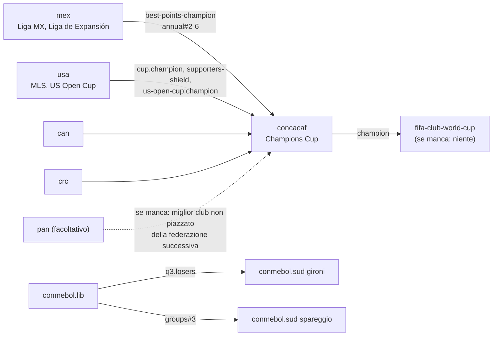

# Moduli e catalogo delle regole per competizioni dichiarative

> Come aggiungere o togliere campionati e coppe (nazionali o continentali) come *moduli* dichiarativi, e l'elenco completo delle regole che il motore deve avere in partenza, ricavato da quelle che il Mod usa nel Mondo 2026-27. Un mondo è un elenco di moduli; i moduli si collegano solo attraverso *porte* con un nome (es. `mex.liga-mx:apertura.champion`), così uno si può togliere o cambiare senza toccare gli altri. Ogni regola è una *primitiva* con nome, campi JSON, test e testo generato; una competizione nuova non richiede codice, solo dati. In fondo: il modulo CONCACAF completo come esempio e cosa controlla il validatore.

Stato: piano, 25/10/2026. Estende la "Proposta del motore" (il modello delle specifiche, §4) con il sistema dei moduli e l'elenco completo delle primitive. Fonti del catalogo: `release/world-2026-27-competitions.md` del Mod (ogni competizione del Mondo 2026-27, generato da `tools/complist.py`), `notes/continental-cups.md`, `notes/CONVENTIONS.md` e gli strumenti citati in ogni riga. Dati e codice del Mod sono riassunti, non copiati.

## 1. Moduli

### 1.1 Cos'è un modulo

Un **modulo** è una cartella che aggiunge competizioni (e i club che servono) a un mondo. Granularità tipica: una nazione (`ita/`), le coppe per club di una confederazione (`concacaf/`), una competizione speciale (`fifa-club-world-cup/`).

```
modules/
  mex/
    module.json          # manifest: id, version, provides, requires, licence, sources
    competitions.json    # specs (proposal §4), one or more competitions
    clubs.json           # club ids, names, area, rivals, squad uuids per season
    names.json           # display names, short forms, round names, per language
    fixtures/2026-27/    # optional: real fixture lists / real draws for season 1
    credits.md           # data sources and their licences
```

`clubs.json` rimanda alle rose nel formato JSON squadre che OpenSWOS usa già (`docs/DATA_JSON.md` §4), così il gioco le carica con il suo caricatore. Un club ha un id stabile (`club:mex.america`); l'uuid della rosa cambia a ogni versione della rosa (`docs/TEAM_IDS.md`), quindi l'associazione è per stagione.

### 1.2 Il manifesto

```json
{
  "id": "mex",
  "version": "2026.10.1",
  "schema": 1,
  "kind": "country",
  "country": "MEX",
  "confederation": "CONCACAF",
  "provides": {
    "mex.liga-mx:apertura.champion":   "club",
    "mex.liga-mx:clausura.champion":   "club",
    "mex.liga-mx:annual":              "ranking",
    "mex.liga-mx:best-points-champion":"club",
    "mex.liga-expansion:annual":       "ranking"
  },
  "requires": {},
  "licence": "data: see credits.md",
  "sources": ["Liga MX Reglamento de Competencia 2026-27"]
}
```

`provides` elenca le **porte** del modulo (§2): le uniche cose che gli altri moduli possono leggere. `requires` elenca le porte di altri moduli che questo legge (un modulo continentale ne richiede molte, una nazione di solito nessuna).

### 1.3 Il manifesto del mondo

```json
{
  "id": "world-2026-27",
  "start_season": "2026-27",
  "calendar_year_leagues": 2026,
  "modules": ["eng", "ita", "esp", "...", "mex", "usa", "crc", "uefa", "conmebol", "concacaf"],
  "seed": 2026,
  "fallbacks": { "unresolved_port": "error" }
}
```

**Aggiungere** un modulo = aggiungere la sua cartella e il suo id in `modules`. **Toglierlo** = cancellare l'id. Il validatore (§5) segnala allora ogni porta rimasta senza fonte; ogni modulo che la usava o dichiara che fine fa quel posto (`if_missing`, §3.9) oppure il mondo non si carica. Niente sparisce in silenzio.

### 1.4 Modifiche dal mondo (override)

Un mondo può modificare un modulo senza toccarlo (es. un mondo storico che vuole la Serie A 1996 a 18 squadre):

```json
{ "override": "ita.serie-a", "set": { "participants.count": 18, "outcomes[relegated].positions": "15-18" } }
```

Gli override si validano come le specifiche e compaiono nelle note delle regole generate per quel mondo.

## 2. Porte

Una porta è `modulo.competizione:selettore`. Selettori:

| Selettore | Significato | Esempio |
|---|---|---|
| `stage#N` / `stage#N-M` | posizioni nella classifica di una fase | `ita.serie-a:table#1-4` |
| `stage.group#N` | posizione in un girone (`*` = ogni girone) | `ita.serie-c:gironi.*#1` |
| `stage.winner` / `.runner-up` / `.losers` | risultati a eliminazione | `conmebol.lib:q3.losers` |
| `champion` | il campione dichiarato della competizione | `bra.copa-do-brasil:champion` |
| `stage.champion` | il titolo di una fase (Apertura, Clausura) | `arg.lpf:apertura.champion` |
| `next(porta)` | il miglior club di una classifica non ancora piazzato altrove | `next(usa.mls:supporters-shield)` |
| `holder(comp)` | il vincitore della scorsa stagione | `holder(concacaf.ccc)` |

L'ordine di risoluzione è dichiarato da chi legge (proposta §4.6 `cascade`), e il motore risolve tutte le porte di un fine stagione in un'unica passata deterministica, nell'ordine dei moduli del mondo e poi per id.

## 3. Catalogo delle regole

Ogni riga è una **primitiva**: una regola con nome, campi JSON, un'implementazione C, test unitari e una frase modello per `swc-explain`. "Fonte nel Mod" indica dove il Mod la implementa oggi; il caso reale viene dal Mondo 2026-27.

### 3.1 Struttura dei campionati

| Primitiva | JSON | Caso reale (Mod 2026-27) | Fonte nel Mod |
|---|---|---|---|
| `round_robin.legs` | `"legs": 1..4` | girone a 4 giri: Canada PL (8 squadre, 28 giornate) e altri 13 campionati | gioco + `split.py` (games) |
| `round_robin.odd_rest` | automatico con n dispari: una squadra riposa a ogni giornata | Malta, Galles, Islanda... | `oddtables.py` |
| `table.size_unlimited` | nessun limite di 24 squadre | Argentina LPF e MLS, 30 squadre | `longtable.py` |
| `groups.parallel` | `"type": "groups", "level_of_pyramid": 3, "allocation": "geographic"` | Serie C 3x20, Serie D 9 gironi, zone di El Salvador, Primera Nacional 2x18 | `pgroups.py` |
| `groups.geographic_move` | promosse e retrocesse entrano nel girone della loro `area` | "promosse e retrocesse vanno nel girone della loro area" | `pgroups.py` + `area` dei club |
| `groups.conferences` | gironi che definiscono solo la classifica, il calendario li incrocia | MLS Est/Ovest | `split.py` (fixtures di fase) |
| `groups.cross_blocks` | `"cross": k`: club in k blocchi che giocano solo contro gli altri blocchi | Paranaense, Catarinense | `statespec.py` |
| `points` | `{win, draw, loss}`; `points.shootout_win` per i pareggi decisi ai rigori | MLS 1997 (vittoria 3, vittoria ai rigori 1, sconfitta 0), vedi §7 | `mls97.py` |
| `no_movement` | divisione senza promozioni né retrocessioni | Liga MX, 82 divisioni più basse | dati |

### 3.2 Calendari e vincoli sulle giornate

| Primitiva | JSON | Caso reale | Fonte nel Mod |
|---|---|---|---|
| `schedule.generated` | metodo del cerchio, `max_run: 3` partite di fila in casa o fuori | ogni campionato generato | regole di `oddtables.py` |
| `schedule.fixed` | `"fixtures": "fixtures/2026-27/arg-lpf.json"` | Argentina e campionati Apertura/Clausura "sul calendario vero" | `argcal.py`, `fixtures` dei pack |
| `schedule.mirror` | secondo torneo = stesse coppie a campi invertiti | Clausura argentino | `argcal.reverse` |
| `rivals` | in `clubs.json`: `"rival": "club:arg.river"` (coppie, anche tra zone diverse) | Boca–River, ogni club LPF ne ha uno | `argcal.py` |
| `constraint.rivals_rest_same_day` | con zone dispari, i due rivali riposano nella stessa giornata e si affrontano nel *clásico* interzonale | zone LPF da 15 | `argcal.py` |
| `special_matchday` | `{"round": 16, "type": "interzonal", "pairing": "draw", "exclude": "rivals"}` | 16ª giornata LPF | `argcal.py` |
| `special_matchday.derbies` | `{"type": "rivals"}`: tutti i derby nella stessa giornata | forma generale della precedente | — |
| `calendar.window` / `months` | finestra della stagione e mesi per fase | turni continentali: preliminari ago-set, gironi ott-dic, eliminazione feb-apr, finale maggio | formati `conti` |
| `calendar.dates` | date vere proiettate sulla griglia settimanale del gioco | prima stagione di ogni campionato | `weeks.py`, pack |
| `league_phase.fixtures` | calendario sorteggiato alla svizzera (k partite ciascuno) | UCL/UEL/UECL a 36; Paulista 2026 (8 partite ciascuno) | `lp36.py`, `statespec.py` |

### 3.3 Split e stagioni a più tornei

| Primitiva | JSON | Caso reale | Fonte nel Mod |
|---|---|---|---|
| `split.after` | `{"after_matchdays": 22, "sections": [...]}` | Scozia, Austria, Grecia, Romania, Bulgaria, Ecuador | `split.py` |
| `split.section.legs` | `0` (nessuna altra partita), `1..4` | girone di mezzo ceco: nessuna altra partita | `split.py` |
| `split.points` | `full`, `half_up`, `half_down`, `none` | Grecia 5-8 e Romania: punti dimezzati per eccesso; Albania: per difetto | `split.py` |
| `split.points_among` | punti portati = metà di quelli fatti contro le squadre della stessa sezione | Moldova | `split.py` |
| `split.keep_table` | punti azzerati ma classifica di apertura conservata come record | Malta (classifica dell'Opening Round conservata) | `split.py` |
| `split.home` | `balance` (chi ha ospitato meno volte l'altra), `reverse_nth` (chi era fuori nell'n-esimo incontro), `seeded` | Scozia/Svizzera/Corea: balance; Irlanda del Nord: fuori nel 3° incontro | `split.py` |
| `tournaments.apertura_clausura` | due fasi `round_robin` con `resets: [points, stats]` | Argentina, Paraguay, Honduras, Guatemala, Costa Rica, Panama, Bolivia | `arg97.py`, `argcal.py` |
| `tournament.final_phase` | eliminazione dopo ogni torneo da `stage#1-N` o `group#1-N` | LPF "prime 8 di ogni gruppo", America centrale "1ª-4ª / 1ª-6ª" | `engine.py` + `gplay.c` |
| `trophy_of_champions` | `single_match` tra i due vincitori dei tornei, `skip_if: same_club` | Trofeo de Campeones (Argentina) | `gplay.c` |
| `aggregate_table` | `of: [apertura, clausura]` per posti e retrocessione | classifica annuale argentina | `arg97.py` |
| `average_table` (promedio) | `seasons: 3, metric: points_per_match` | DESCENSO argentino | moduli Argentina |
| `stage_titles` | il vincitore di una fase è un titolo a sé (albo d'oro, access list) | campioni di Apertura / Clausura che danno posti CONMEBOL | `conti` + `gplay` stage_title |

### 3.4 Classifiche e criteri di parità

| Primitiva | JSON | Caso reale | Fonte nel Mod |
|---|---|---|---|
| `tiebreakers` | lista ordinata (proposta §4.4), scontri diretti ricorsivi | ogni campionato con i suoi criteri veri | `zones.py` / dati |
| `tiebreak.faithful_1996` | punti, differenza reti, gol fatti, nome | il mondo originale del 1996 | gioco |
| `table.legend_zones` | etichette `zone` degli esiti per posizione, per girone | CL / EL / CONF / PROM / P.OFF / P.OUT / RETR, legenda sopra la tabella | `zones.py` (CONVENTIONS 5-7) |
| `points.adjustment` | `{"club": ..., "points": -N, "reason": ...}` nei dati della prima stagione | penalizzazioni dove reali | dati |

### 3.5 Turni a eliminazione

| Primitiva | JSON | Caso reale | Fonte nel Mod |
|---|---|---|---|
| `decider` | lista ordinata: `aggregate`, `away_goals`, `extra_time`, `penalties`, `better_placed`, `replay` | "andata e ritorno (somma dei gol, poi rigori, senza supplementari)", "supplementari, poi la meglio piazzata" | `gplay.c` (CONVENTIONS 10) |
| `decider.one_per_round` | un modo di decidere per turno, scelto dalla lista; mai inventato per una competizione | CONVENTIONS 10 | — |
| `home.better_placed` | gara unica in casa della meglio piazzata; a due gare: ritorno in casa della meglio piazzata | play-out Serie C, fasi finali LPF | `gplay.c` |
| `home.real_schedule` | ordine casa/fuori come nel calendario vero (prima stagione), poi una regola dichiarata | primo turno dei play-off EFL | pack |
| `home.drawn` / `home.neutral` | ordine sorteggiato; campo neutro | "ordine casa/fuori sorteggiato"; finali in campo neutro | `gplay.c` |
| `home.better_record` | finale in casa della finalista con la miglior differenza reti nei turni precedenti | finale della CONCACAF Champions Cup | formato `conti` |
| `skip_if.points_gap` | il turno non si gioca se il distacco è di almeno N punti (retrocede la peggiore) | play-out Serie C/D: 8 punti | `gplay.c` |
| `skip_if.same_club` | non si gioca se la stessa squadra è da entrambe le parti | Trofeo de Campeones, CPL | `gplay.c` |
| `round_names` | turni chiamati e numerati come nella realtà, per lingua | "turni numerati come nella realtà" | `complist.py`, nomi |

### 3.6 Play-off e play-out

| Primitiva | JSON | Caso reale | Fonte nel Mod |
|---|---|---|---|
| `playoff.purpose` | `promotion`, `title`, `placement`, `continental_place`, `playout` | nel Mondo 2026-27: 19 play-off promozione, 12 play-out, 10 piazzamento, 5 titolo, 3 posto europeo | `engine.py` + `gplay.c` |
| `playoff.entrants_multi` | partecipanti da più classifiche | 16ª Bundesliga + 3ª 2. Bundesliga; poule scudetto Serie D (9 vincitrici di girone) | pack |
| `playoff.bracket` | coppie dichiarate per posizione (`"#3-#6"`), bye per le teste di serie | play-off Championship 3ª-8ª; Reducido (Argentina) | `gplay.c` |
| `playoff.seeds_from_rounds` | teste di serie = classifiche dei turni della stagione | play-off titolo di Malta | `gplay.c` |
| `playoff.loser_out_of_world` | la perdente va nella riserva (fuori dal mondo) | play-out Serie D (9 casi) | `ripool.py` |
| `playoff.european_place` | un posto che porta solo a uno spareggio si colora P.OFF, non con il colore della coppa | Austria, Olanda, Danimarca, Bulgaria | `zones.py` (CONVENTIONS 7) |

### 3.7 Movimenti nella piramide

| Primitiva | JSON | Caso reale | Fonte nel Mod |
|---|---|---|---|
| `outcome.promoted/relegated` | posizioni + competizione di destinazione | "2 su; 3 giù" (EFL Championship) | gioco + dati |
| `outcome.lowest_division` | "nessuno retrocede": il fondo del mondo | 82 divisioni | dati |
| `outcome.via_playoff` | promozione/retrocessione decisa da una fase di play-off | Serie B, EFL, Reducido LPF | `engine.py` |
| `pool.off_file` | club fuori dai file giocabili che possono entrare e uscire (pool) | pool Eccellenza, pool secondari, club solo statali | `ripool.py`, `worldpool.py` (CONVENTIONS 13) |

### 3.8 Coppe nazionali

| Primitiva | JSON | Caso reale | Fonte nel Mod |
|---|---|---|---|
| `cup.entry_by_round` | per divisione, il turno in cui entra un club | "entrano: 1° turno 14, quarti 1"; 70 coppe con "N bye fino al 2° turno" | `cupsf.py`, pack |
| `cup.byes` | bye per arrivare a una potenza di due | Coppa Italia Serie C: 15 bye fino al 2° turno | gioco + dati |
| `cup.season1_real` | prima stagione = squadre ancora in corsa e abbinamenti veri del primo turno; poi sorteggio | 33 + 17 + 10 coppe "come davvero sorteggiate" | `cupsf.py`, `cupd.py` |
| `cup.round_rules` | regole diverse per turno (es. andata e ritorno solo in semifinale) | EFL Cup: 3° turno a due gare, finale secca | dati |
| `cup.whole_division` | entra ogni club di un livello | Coppa Italia Serie D (162 club) | `cupd.py` |
| `cup.in_game_subset` | la coppa vera ha N squadre, il gioco ne gioca M dal turno k | Canadian Championship: 15 vere, 8 nel gioco | `complist.py` |
| `state_championship` | competizioni sub-nazionali (gironi + eliminazione) prima della stagione nazionale | campionati statali brasiliani | `statespec.py`, `statecup.py` |

### 3.9 Coppe continentali per club

| Primitiva | JSON | Caso reale | Fonte nel Mod |
|---|---|---|---|
| `access_list` | per federazione: posti per posizione, vincitrice della coppa, `next`, titoli di fase | CONMEBOL, CONCACAF, AFC, CAF, OFC; matrice UEFA 2026-27 | `conti.c`/`.py`, `uefaq.c` |
| `access.coefficients` | coefficienti simulati di federazione e club spostano i posti dalla seconda stagione | "dalla stagione 2: Champions League N ... per coefficienti simulati" | `uefacoef.py` |
| `access.cascade` | i posti non usati scalano secondo una regola dichiarata (detentore già qualificato, eccedenze oltre le prime 9) | posti UEFA per posizione | `uefaq.c` |
| `access.holders` | posti dei detentori (vincitrice della coppa -> stessa coppa, vincitrice dell'Europa League -> CL ...); sempre risolti con il §3.12, mai applicati direttamente | detentore UCL + vincitrice UEL | `uefaq.c` |
| `access.if_missing` | posto di una federazione/coppa che non è nel mondo -> destinazione dichiarata | posti "outside" CONCACAF; posti di Leagues Cup / coppa centroamericana ai campionati dei loro paesi | `concacaf.access.json` |
| `qualifying_rounds` | percorso campioni / piazzate, teste di serie per coefficiente | preliminari UEFA Q1-Q3 + spareggio, preliminari Libertadores Q1-Q3 | `uefaq.c`, `conti` |
| `draw.pots` | fasce per ranking, `same_assoc: no / allow_if_via`, detentore in A1 | gironi Libertadores; ACL | `conti` |
| `draw.seeded_bracket` | posizioni da testa di serie + bye | 1° turno CONCACAF CC (5 bye) | `conti` |
| `league_phase` | fase svizzera a 36, 2 avversarie per fascia, protezione per nazione | UCL/UEL/UECL 2026-27; league stage ACL Elite | `lp36.py` |
| `cross_cup` | le perdenti di un turno o un piazzamento di girone passano a una fase di un'altra coppa | perdenti Q3 Libertadores -> gironi Sudamericana; 3ª di girone Libertadores -> spareggio Sudamericana | `conti` (`losers`, `out`) |
| `feeder_cups` | coppe regionali le cui vincitrici entrano in una coppa più grande | coppa centroamericana / caraibica -> CONCACAF CC | `concacaf.access.json` (dichiarate, non nel mondo) |
| `guest_clubs` | club fuori dai campionati del mondo che giocano solo una coppa continentale (rose ospiti) | `*.guests.json` per ogni confederazione | `conti`, dati guests |
| `season1_entrants` | i partecipanti veri della prima edizione | `entrants_season1` in ogni file di accesso | `conti` |
| `super_cup` | gara secca / andata e ritorno tra due vincitrici di coppa | Supercoppa UEFA, Recopa | `conti`, Supercoppa 4.0 |

### 3.12 Diritti di qualificazione, precedenza e garanzie

Una segnalazione vera sulla 4.0.1 del Mod mostra perché serve una primitiva apposta. Carriera con il Milan: nella stagione 2 il club vince la Serie A *e* la Conference League; nella stagione 3 gioca l'Europa League invece della Champions League. Il posto della vincitrice della Conference (verso l'Europa League) è stato applicato dopo quello della campionessa d'Italia, e ci è finito sopra. Nel codice imperativo il risultato dipende dall'ordine in cui girano due pezzi di codice; nel motore deve dipendere solo dalle regole dichiarate.

**Diritti, non assegnazioni.** A fine stagione il risolutore dei link raccoglie prima, per ogni club, *tutti* i posti a cui ha diritto (posizione in campionato, coppa vinta, detentore, posto da coefficiente), ognuno come un diritto `{club, competizione di destinazione, fase, origine}`. Ancora non assegna niente.

**Un'unica precedenza dichiarata.** Ogni modulo di confederazione dichiara l'ordine delle sue competizioni e fasi, dalla migliore alla peggiore:

```json
"precedence": [ "uefa.ucl:league-phase", "uefa.ucl:play-off", "uefa.ucl:q3", "uefa.ucl:q2", "uefa.ucl:q1",
                "uefa.uel:league-phase", "uefa.uel:play-off", "uefa.uel:q3",
                "uefa.uecl:league-phase", "uefa.uecl:play-off", "uefa.uecl:q3", "uefa.uecl:q2", "uefa.uecl:q1" ]
```

Il risolutore dà a ogni club il suo diritto **migliore** secondo questa lista. Ogni altro diritto di quel club diventa un **posto liberato**, riempito dalla regola `cascade` dichiarata per quel posto (club successivo dello stesso campionato, o il ribilanciamento dell'access list, come prevede la stessa access list UEFA). L'ordine in cui girano moduli, competizioni o codice non può cambiare il risultato: l'algoritmo è "vince il diritto migliore, poi si scala", applicato a tutto l'insieme insieme, ripetuto finché non cambia più niente (finisce sempre: ogni passo sposta un club più in alto nella lista o riempie un posto).

**Garanzie.** Un modulo può dichiarare cosa deve essere sempre vero, e il motore lo controlla a ogni fine stagione:

```json
"guarantees": [
  { "club": "ita.serie-a:champion", "plays": "uefa.ucl", "stage_at_least": "uefa.ucl:league-phase" },
  { "club": "uefa.uecl:champion",   "plays_at_least": "uefa.uel:league-phase" }
]
```

Una garanzia si controlla tre volte:

1. dal **validatore**, che dimostra sulla precedenza dichiarata che nessuna combinazione di diritti può violarla (qui: il diritto della campionessa di Serie A è `ucl:league-phase`, il primo della lista, quindi nessun altro diritto può spingerla più in basso);
2. dai **test di proprietà** (strategia di test L2), che danno a club casuali combinazioni casuali di titoli;
3. **a runtime**: se a un fine stagione una garanzia risultasse falsa, il motore si ferma con un errore che nomina il club, la garanzia e i diritti coinvolti, invece di produrre una stagione sbagliata.

Così il caso del Milan diventa una regola dichiarata ("la campionessa di Serie A gioca sempre la league phase della Champions League"), una riga nella lista di precedenza e uno scenario (strategia di test L3) che forza la doppia vittoria. Non può più dipendere dall'ordine di due percorsi di codice.

### 3.10 Regole di carriera e di mondo

| Primitiva | JSON | Caso reale | Fonte nel Mod |
|---|---|---|---|
| `visibility.real_only` | un club in carriera gioca (e vede nel calendario) solo ciò che giocherebbe il club vero; le altre competizioni si simulano per vincitori e detentori | club di Serie D: il suo girone + Coppa Italia Serie D (CONVENTIONS 11) | logica di mondo del Mod |
| `simulate.world_wide` | ogni competizione non giocata dal giocatore si simula ogni stagione, così ogni coppa ha vincitrice, finalista, detentori, albo d'oro | tutte le coppe continentali | `conti.c`, `simdraw.py` |
| `honours.path` | il turno raggiunto da ogni club, per albo d'oro e resoconto di stagione | tutte le coppe | `conti` |
| `season_naming` | edizione chiamata con l'anno (la 2026-27 gioca le edizioni 2027) | coppe continentali | `conti` |

### 3.11 Presentazione (generata dalle specifiche)

| Primitiva | JSON | Caso reale | Fonte nel Mod |
|---|---|---|---|
| `names.lang` | nomi per lingua con `short` e limite di larghezza | titoli di 35 byte, etichette di calendario di 70 px, 4 lingue | `titlelegs.py`, `complist.py` (CONVENTIONS) |
| `explain` | pagina FORMAT e note delle regole generate dalla specifica, per lingua | pagine FORMAT, "Ogni nazione, ogni competizione" | `fmtpage.py`, `fmtprose.py`, `complist.py` |
| `zones` | colori + legenda dalle etichette degli esiti | tutte le classifiche | `zones.py` |

## 4. Esempio: il modulo CONCACAF

Costruito dai dati CONCACAF del Mod (`internal/conti/concacaf.*.json`, privati), riscritti nello schema proposto. La forma della Champions Cup 2026: 27 club, 22 al 1° turno e 5 con bye agli ottavi, andata e ritorno con gol in trasferta e poi rigori, finale secca in casa della finalista con la miglior differenza reti.

`modules/concacaf/module.json`

```json
{
  "id": "concacaf", "version": "2026.10.1", "schema": 1, "kind": "confederation",
  "provides": { "concacaf.ccc:champion": "club", "concacaf.ccc:final.runner-up": "club" },
  "requires": {
    "mex.liga-mx:best-points-champion": "club", "mex.liga-mx:annual": "ranking",
    "usa.mls:cup.champion": "club", "usa.mls:supporters-shield": "ranking", "usa.us-open-cup:champion": "club",
    "can.cpl:annual": "ranking", "can.canadian-championship:champion": "club",
    "crc.primera:annual": "ranking"
  },
  "optional": [ "gua.liga-nacional:champion", "hon.liga-nacional:champion", "pan.lpf:champion",
                "slv.primera:champion", "sur.topklasse:champion" ]
}
```

`modules/concacaf/competitions.json` (estratto)

```json
{
  "id": "concacaf.ccc",
  "kind": "continental",
  "names": { "en": "CONCACAF Champions Cup", "it": "CONCACAF Champions Cup", "short": "CONCACAF CHAMP." },
  "edition_naming": "next_year",
  "participants": { "count": 27, "source": "access_list" },
  "access_list": {
    "mex": [ ["r16", "mex.liga-mx:best-points-champion"], ["r1", "mex.liga-mx:annual#2-6"] ],
    "usa": [ ["r16", "usa.mls:cup.champion"], ["r16", "next(usa.mls:supporters-shield)"],
             ["r1", "usa.mls:supporters-shield#1-5"], ["r1", "usa.us-open-cup:champion"],
             ["r1", "next(usa.mls:supporters-shield)"] ],
    "can": [ ["r1", "can.cpl:annual#1-2"], ["r1", "can.canadian-championship:champion"] ],
    "crc": [ ["r16", "crc.primera:annual#1"], ["r1", "crc.primera:annual#2"] ],
    "gua": [ ["r1", "gua.liga-nacional:champion"] ],
    "hon": [ ["r1", "hon.liga-nacional:champion"] ],
    "pan": [ ["r1", "pan.lpf:champion"] ],
    "slv": [ ["r1", "slv.primera:champion"] ],
    "sur": [ ["r1", "sur.topklasse:champion"] ],
    "cascade": "next_in_league",
    "if_missing": { "default": "next_ranked_association_best_unplaced" },
    "guests": "guests.json"
  },
  "stages": [
    { "id": "r1", "type": "knockout", "month": 2,
      "pairing": { "method": "seeded_bracket", "pots_by": "concacaf_club_ranking" },
      "rounds": [ { "legs": 2, "home": "better_placed_second_leg", "decider": ["aggregate", "away_goals", "penalties"] } ] },
    { "id": "ko", "type": "knockout", "entrants": ["byes:r16", "r1.winners"], "pairing": "bracket",
      "rounds": [
        { "name": "round-of-16",    "month": 3, "legs": 2, "home": "better_placed_second_leg", "decider": ["aggregate", "away_goals", "penalties"] },
        { "name": "quarter-finals", "month": 4, "legs": 2, "home": "better_placed_second_leg", "decider": ["aggregate", "away_goals", "penalties"] },
        { "name": "semi-finals",    "month": 4, "legs": 2, "home": "better_placed_second_leg", "decider": ["aggregate", "away_goals", "penalties"] },
        { "name": "final",          "month": 5, "legs": 1, "home": "better_record:goal_difference", "decider": ["extra_time", "penalties"] } ] }
  ],
  "outcomes": [ { "from": "ko", "positions": 1, "tag": "champion",
                  "to": "fifa.club-world-cup", "if_missing": "drop" } ],
  "season1": { "entrants": "fixtures/2027/entrants.json" }
}
```



Cosa succede quando i moduli entrano ed escono:

- **Togli `pan`**: la sua porta è in `optional`, quindi il suo posto segue `if_missing` (il miglior club non piazzato della federazione successiva nel ranking). Il validatore riporta lo spostamento nelle note delle regole del mondo.
- **Togli `usa`**: le sue porte sono in `requires`, quindi il mondo non si carica finché non si toglie anche `concacaf` o non si modifica la sua access list. È voluto: una CONCACAF senza MLS è una scelta di progetto, non un incidente.
- **Aggiungi `jam`** (Giamaica): aggiungi il modulo e una riga di accesso (un override nel mondo o una nuova versione di `concacaf`). Nessun codice.

## 5. Il validatore

`swc-validate world.json` controlla, in quest'ordine:

1. **Schema**: il JSON di ogni modulo contro la versione di schema che dichiara.
2. **Porte**: ogni `requires` risolto; ogni `optional` risolto o coperto da `if_missing`; nessuna porta fornita da due moduli.
3. **Conteggi**: i partecipanti di ogni fase = la dimensione della fase (bye compresi); le access list riempiono `participants.count` anche nel caso *peggiore* (dopo scalate e ripieghi).
4. **Piramide**: ogni promozione ha un posto di retrocessione corrispondente un livello sopra/sotto (per area con i gironi paralleli), e la divisione più bassa dichiara `lowest_division`.
5. **Calendario**: ogni fase sta nei suoi mesi; nessun club deve giocare due partite nella stessa settimana (la classe di errori che il Mod ha incontrato con le tabelle dispari e i calendari di carriera).
6. **Sorteggi**: ogni sorteggio con vincoli è risolvibile per i partecipanti della prima stagione e per un campione di stagioni generate.
7. **Testi**: nomi in ogni lingua dichiarata, entro i limiti di larghezza, solo con caratteri che il font del gioco ha.
8. **Prova di simulazione**: tre stagioni con il fornitore finto, nessuno stato irrisolto, nessun club in due divisioni, golden file scritto per la revisione.

## 6. Come segue il codice (quasi in automatico)

- **Un registro delle primitive.** Ogni primitiva è una voce: frammento di schema, funzione/i C, test unitari, frasi modello in ogni lingua. Lo schema e la sua documentazione di riferimento sono generati dal registro, così i documenti non possono divergere dal codice.
- **Aggiungere una competizione non aggiunge mai codice.** Aggiunge un modulo; l'integrazione continua lo valida e lo simula.
- **Aggiungere una regola** (raro) è una pull request: voce del registro + implementazione + test + frasi modello, revisionata da sola ("Linee guida AI"). Il catalogo qui sopra è l'insieme obiettivo della versione 1, così il Mondo 2026-27 non ha bisogno di regole nuove dopo.
- **Importatori** convertono i dati che il Mod ha già in moduli: campionati/split/gironi paralleli di `pack.json`, campionati statali di `statespec`, formati e access list di `conti`, tabelloni veri delle coppe di `cupsf`. L'uscita di `complist.py` del Mod per il Mondo 2026-27 diventa il test di accettazione: `swc-explain` deve dire la stessa cosa per ogni competizione.
- **Modelli di partenza**: `swc new country mex --levels 2 --cup`, `swc new confederation concacaf` scrivono lo scheletro di un modulo con segnaposto e una validazione che fallisce elencando cosa riempire.

## 7. Punti aperti

1. **Punti ai rigori** (la stagione MLS 1997 del Mod: vittoria 3, vittoria ai rigori 1, sconfitta 0): restano come `points.shootout_win` per i mondi storici; prima della versione 1 controllare quali altre stagioni del Mod li usano (i pack NZ e Africa parlano di shoot-out).
2. **Ripetizioni** (FA Cup storica): `decider: replay` richiede posti nel calendario; solo mondi storici.
3. **Coefficienti tra mondi**: un mondo senza alcune federazioni calcola i ranking solo dai moduli presenti; decidere se si possono usare ranking reali congelati (il Mod ha congelato quello 2025 per la 4.0).
4. **Club ospiti** nelle coppe continentali: stesso formato delle rose, ma se si possono acquistare nel mercato è una regola di carriera da decidere (CONVENTIONS 13 del Mod: i club fuori file non devono mai bloccare nessun percorso).
5. **Granularità dei moduli**: uno per nazione è naturale; un mondo potrebbe volere "Italia senza Serie D" (un override che toglie un livello): il controllo della piramide deve allora accettare un fondo sopra la Serie D.
