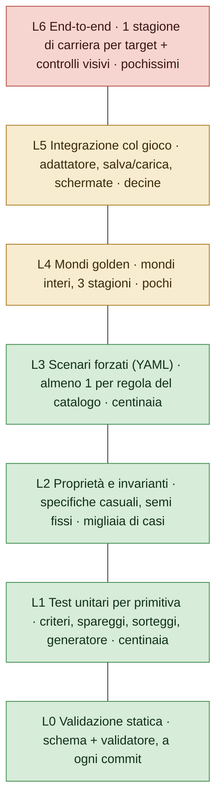

# Strategia di test per il motore delle competizioni

> Oggi il Mod verifica quasi tutto con test end-to-end: il gioco vero in DOSBox-X, una suite da circa 12 minuti più una carriera da 20 stagioni, perché la logica è dentro l'exe. Con un motore separato dal gioco la piramide si rovescia: quasi tutto si verifica in millisecondi con test sulle singole regole, test di proprietà e scenari "forzati" scritti in YAML leggibile, più pochi golden file di mondi interi. I test end-to-end restano pochissimi: una stagione di carriera per target e i controlli visivi. Ogni bug diventa un test al livello più basso possibile, mai un nuovo test end-to-end.

I termini di questa parte:

- **end-to-end**: si fa girare il gioco intero, come lo usa un giocatore;
- **harness**: il programma che guida il gioco da solo (preme i tasti, legge la memoria) e controlla i risultati;
- **test unitario**: controlla una sola regola con ingressi e uscita fissati;
- **test di proprietà**: genera molti casi casuali e verifica che certe condizioni valgano sempre (es. ogni coppia si incontra `legs` volte);
- **scenario**: un piccolo file che impone una situazione precisa (con il fornitore scritto a mano) e dice cosa deve succedere;
- **integrazione continua (CI)**: i test girano da soli a ogni modifica inviata al repository;
- **poke** e interruttori **`*_FORCE`**: i trucchi del Mod per forzare un caso, scrivendo direttamente nella memoria del gioco o compilando un exe speciale.

Stato: piano, 25/10/2026. Accompagna la parte B (Proposta del motore) §6 (determinismo e golden file) e la parte C (Moduli e catalogo) (le primitive da testare).

## 1. Perché la piramide cambia

Nel Mod ogni regola di formato vive dentro l'eseguibile del 1996, quindi l'unico modo per vederla funzionare è far girare il gioco: `tools/swostest.py` lo gioca in DOSBox-X con l'invio di tasti e la lettura della memoria. È un buon harness e ha trovato trappole vere, ma è lento (la suite completa richiede circa 12 minuti su quattro DOSBox, la carriera da 20 stagioni molto di più), ha bisogno di trucchi (poke, build con interruttori `*_FORCE`) per arrivare ai casi rari, e un errore indica un indirizzo di memoria invece di una regola.

Con il motore separato dal gioco (proposta §3) una regola è una funzione C con ingressi e uscite. Si può testare direttamente, e i test scendono nella piramide:



La quota obiettivo, per numero di test: L0-L3 circa 95%, L4-L5 circa 5%, L6 una manciata. Per tempo: tutto L0-L5 sotto il minuto su un portatile, quindi gira a ogni commit; L6 gira prima di un rilascio.

## 2. I livelli

### L0 — Validazione statica

`swc-validate` (catalogo delle regole §5) su ogni modulo di ogni mondo del repository: schema, porte, conteggi, piramide, mesi del calendario, sorteggi risolvibili, larghezza e caratteri dei nomi. La maggior parte degli errori nei dati non arriva mai a una simulazione. Ogni controllo del validatore ha i suoi test: un modulo d'esempio rotto che deve essere rifiutato con il messaggio atteso.

### L1 — Test unitari per primitiva

Ogni voce del registro (catalogo §6) porta con sé test unitari in C, scritti come tabelle di casi. Esempi:

| Primitiva | Casi tipici |
|---|---|
| `tiebreakers` | tre squadre a pari punti, gli scontri diretti ne separano due, poi la differenza reti la terza (mini-classifica ricorsiva) |
| `decider` | 1-0 / 0-1 con gol in trasferta disattivati -> supplementari; 2-1 / 1-0 con gol in trasferta attivi -> passa chi era fuori all'andata |
| `split.points` | 35 punti `half_up` -> 18, `half_down` -> 17; `points_among` della Moldova |
| `average_table` | promedio confrontato con prodotti incrociati: 1,333... contro 4/3 esattamente uguali -> criterio successivo |
| `draw.pots` + vincoli | 36 club, 4 fasce, nessuna coppia della stessa federazione -> soluzione trovata; insieme impossibile -> `unsatisfiable` |
| generatore casuale | vettori di risposta nota: seme 42, scopo "x" -> le prime 16 uscite fissate per sempre |

I test unitari non usano file né il gioco; girano in microsecondi e su ogni target, compresa la build Amiga (big-endian, 32 bit), che scopre presto gli errori di ordine dei byte e di larghezza.

### L2 — Proprietà e invarianti

Specifiche casuali ma valide (generate dentro lo schema) e risultati casuali, su una lista fissa di semi così che ogni errore sia riproducibile. Invarianti che devono valere sempre:

- in un girone all'italiana ogni coppia si incontra esattamente `legs` volte; nessun club gioca due volte nella stessa giornata; con un numero dispari di squadre ogni club riposa lo stesso numero di volte (il difetto delle tabelle dispari del gioco originale verrebbe scoperto subito qui);
- punti = punti vittoria × vittorie + punti pareggio × pareggi (+ penalizzazioni dichiarate); in una classifica la somma dei gol fatti = somma dei gol subiti;
- ogni posto di promozione ha un posto di retrocessione corrispondente; nessun club finisce in due divisioni o in nessuna;
- ogni turno a eliminazione produce esattamente una vincente; bye + partecipanti = dimensione del tabellone;
- ogni sorteggio con vincoli li rispetta;
- ogni club riceve il suo diritto **migliore** secondo la precedenza dichiarata, e ogni garanzia dichiarata vale (catalogo delle regole §3.12): club casuali vincono combinazioni casuali di campionato, coppa e titoli continentali;
- **determinismo**: lo stesso ingresso fatto girare due volte dà un'uscita identica byte per byte; aggiungere un modulo estraneo non cambia i sorteggi di nessun'altra competizione (flussi separati del generatore, proposta §6).

Un caso casuale che fallisce viene ridotto a una specifica minima e salvato come scenario di regressione (L3).

### L3 — Scenari forzati

È il livello che sostituisce la maggior parte delle partite end-to-end di oggi. Uno scenario è un piccolo file YAML: un frammento di specifica (o il riferimento a un modulo), un **fornitore di risultati scritto a mano** che forza esattamente i risultati che servono al caso, e l'esito atteso. Niente partite rigiocate sperando nel caso giusto: il risultato si forza, come chiede già la CONVENTIONS 15 del Mod.

```yaml
# scenarios/ita/serie-c-playout-gap.yaml
name: play-out di Serie C non giocato con 8 o più punti di distacco
uses: modules/ita#ita.serie-c
force:
  table: { gironi.A: { "#16": { points: 40 }, "#19": { points: 31 } } }
expect:
  - playout.A.tie("#16-#19"): not_played      # il play-out non si gioca
  - relegated: [ "gironi.A#19" ]              # la 19ª retrocede direttamente
  - zones: { "gironi.A#19": RETR }            # e in classifica è colorata RETR
```

```yaml
# scenarios/conmebol/q3-losers-to-sudamericana.yaml
name: le perdenti del 3° turno preliminare della Libertadores entrano nei gironi della Sudamericana
uses: [modules/conmebol, modules/arg, modules/bra]
force:
  results: { conmebol.lib.q3: { tie1: [ [1, 0], [0, 2] ] } }    # andata 1-0, ritorno 0-2
expect:
  - conmebol.lib.q3.tie1.winner: away_side
  - conmebol.sud.groups.entrants contains: conmebol.lib.q3.tie1.loser
```

```yaml
# scenarios/uefa/league-champion-beats-uecl-winner.yaml
# Dalla segnalazione di un giocatore sulla 4.0.1 del Mod: il Milan ha vinto Serie A e Conference
# League e poi ha giocato l'Europa League. Lo scudetto deve valere sempre la Champions League.
name: la campionessa di Serie A che vince anche la Conference League gioca la Champions League
uses: [modules/uefa, modules/ita]
force:
  champion: { ita.serie-a: club:ita.milan, uefa.uecl: club:ita.milan }
expect:
  - next_season.uefa.ucl.league-phase contains: club:ita.milan     # va in Champions
  - next_season.uefa.uel.entrants not contains: club:ita.milan     # non in Europa League
  - vacated: { "uefa.uel:league-phase (uecl winner)": filled_by_cascade }   # il posto liberato scala
```

Regole per gli scenari:

- ogni primitiva del catalogo ha almeno uno scenario; il controllo del registro fallisce se ne manca uno;
- ogni bug segnalato da un giocatore diventa uno scenario al livello più basso che lo riproduce, mai un nuovo test end-to-end (cambia la CONVENTIONS 16 del Mod, che oggi chiede uno scenario dell'harness per ogni bug);
- gli scenari sono testo semplice che anche chi non programma può leggere e scrivere: Davide può aggiungerne uno per un formato che conosce.

### L4 — Mondi golden

Pochi mondi interi simulati senza interfaccia con il fornitore automatico (proposta §6): il Mondo 2026-27 per tre stagioni, il mondo del 1996, un mondo storico. L'uscita (ogni classifica, tabellone, sorteggio, risoluzione dei link, albo d'oro) è un file JSON confrontato con il golden file nel repository. Una differenza va spiegata nel commit che la causa. I mondi golden scoprono le interazioni tra moduli che gli scenari non coprono (scalate dei posti continentali, passaggi tra coppe, movimenti nella piramide su più stagioni).

Un golden speciale dimostra l'**equivalenza col 1996**: il percorso fedele di OpenSWOS e il motore, con lo stesso seme e gli stessi risultati, devono produrre la stessa stagione (test differenziale, fase 2 del piano di migrazione).

### L5 — Integrazione col gioco

Test dell'adattatore tra OpenSWOS e il motore, eseguiti dal gioco in una modalità senza interfaccia, sullo schema delle modalità di autotest che il gioco ha già (`--custom-team-selftest`, `--dos-sound-selftest`) (proposta: `--comp-selftest`):

- una stagione guidata dal vero codice di carriera con partite simulate, controllando che ogni evento del motore venga consumato e ogni risultato inviato;
- salvataggio in mezzo a ogni tipo di fase, caricamento, prosecuzione: l'esito è uguale a quello di una stagione senza interruzioni;
- le schermate (classifica, calendario, tabellone, zone) si disegnano dai dati del motore senza campi mancanti;
- i salvataggi di versioni vecchie si caricano tramite le migrazioni dichiarate.

### L6 — End-to-end, pochi

- Una stagione di carriera per target (PC con SDL, e Amiga con AmigaScope, l'harness di OpenSWOS per l'emulatore Amiga), con i menu guidati da input iniettato, l'impostazione dei tester senza infortuni né cartellini (`no_injuries_cards`), così il pulsante VIEW RESULT fa scorrere la stagione senza domande, e la traccia dei menu (`make SWOS_DEBUG=1`) come diagnostica: dimostra che tutta la catena parte, salva e chiude una stagione.
- Controlli visivi delle schermate nuove (una classifica con le zone, un tabellone, una pagina FORMAT), guardati da una persona, come il giro visivo del Mod prima di ogni release candidate.
- Nient'altro. Una regola che si può controllare solo end-to-end è il segno che la regola è finita nel codice del gioco.

## 3. Cosa cambia rispetto alle abitudini del Mod

| Oggi nel Mod | Con il motore |
|---|---|
| una funzione nuova riceve uno scenario dell'harness DOSBox | una regola nuova riceve test unitari + uno scenario YAML; una competizione nuova riceve validazione + aggiornamento di un mondo golden |
| casi che dipendono dai risultati forzati con poke e build `*_FORCE` | forzati dal fornitore di risultati scritto a mano; nessuna build speciale |
| carriera da 20 stagioni prima di un rilascio | un mondo golden da 20 stagioni senza interfaccia (secondi), più la stagione L6 per target |
| bisezione di un errore rigiocando scenari da soli in DOSBox | lo scenario che fallisce nomina la regola; la differenza del golden nomina competizione e stagione |
| suite di ~12 minuti su 4 DOSBox | L0-L5 sotto il minuto a ogni commit |

## 4. Strumenti e integrazione continua

- **Test isolati**: ogni test costruisce il suo mondo dai file; nessuna cache o stato condiviso tra test (le esecuzioni in serie dell'harness del Mod hanno prodotto falsi errori proprio per cache di moduli condivise).
- **Dati distribuiti**: mondi golden e L5 girano sui data pack che si rilasciano davvero, mai solo su dati di test (CONVENTIONS 17a del Mod: un crash esisteva solo nelle build di rilascio).

- `swc-test` esegue L0-L4 (test unitari C con un piccolo esecutore, scenari e mondi golden con `swc-sim`); `make test` in OpenSWOS aggiunge L5.
- Matrice dell'integrazione continua: SDL x86_64 e arm64 a ogni commit; la build Amiga per i test unitari e L5 ogni notte (il target più severo, come dice `.claude/CLAUDE.md`).
- La copertura si misura per primitiva, non per riga: il registro elenca i test unitari e gli scenari di ogni primitiva, e l'integrazione continua fallisce se una primitiva non ne ha.
- I dati di test stanno con il modulo che li usa (`modules/ita/scenarios/`): togliere un modulo toglie i suoi scenari, aggiungerne uno porta i suoi.

## 5. Primi passi

1. La fase 0 del piano di migrazione è già un test: una stagione golden dell'OpenSWOS attuale, prima che esista codice del motore.
2. I vettori di risposta nota del generatore e il formato dei file di scenario si definiscono prima della prima primitiva.
3. Le prime primitive (girone all'italiana, criteri di parità, modi di decidere un turno) arrivano con test L1 + L2 + L3 nella stessa pull request; il golden della piramide inglese 1996 arriva con la fase 2.
