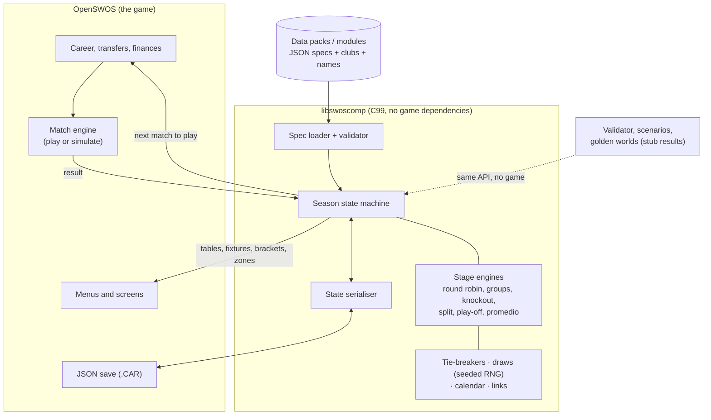
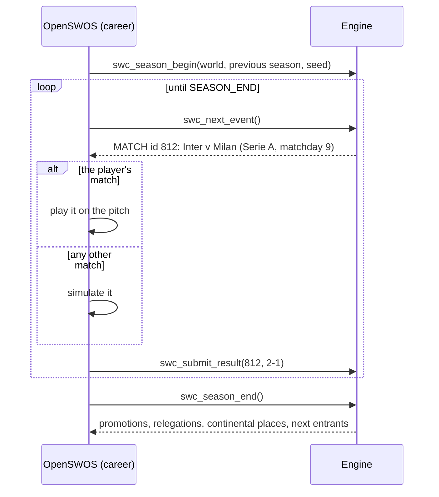

# A deterministic competition engine for OpenSWOS — convergence proposal

> **Sintesi (IT).** Proposta: un *motore delle competizioni* separato dal gioco (libreria C99 senza
> dipendenze, compilabile anche per Amiga), guidato da **specifiche dichiarative** (JSON, validate da
> JSON Schema) che descrivono ogni competizione come una sequenza di *fasi* (girone all'italiana,
> gironi, eliminazione diretta, play-off/play-out, split, Apertura/Clausura, tabelle aggregate,
> promedio) collegate da *link* (qualificazioni, promozioni, retrocessioni, posti continentali).
> Il motore non gioca le partite: chiede i risultati al gioco tramite una callback, così la logica dei
> formati è testabile da sola. Tutto è **deterministico**: stessa spec + stesso seme + stessi
> risultati = stessa stagione, verificata da *golden file*. I formati del 1996 diventano spec
> "originali" (il gioco classico resta identico); i formati del mod diventano *data pack*. Il
> documento mostra quattro formati reali nella spec (Liga MX, Serie C, Champions League league
> phase, Argentina con promedio) e un piano a fasi, con le domande di licenza per Davide.

Status: proposal for discussion, 2026-10-25. Companion of `competitions-in-openswos.md` (the
current state) and `ai-development-guidelines.md` (how the work would be done).

---

## 1. Goals and non-goals

**Goals**

1. Any league, cup or multi-stage competition of any country, season or era expressible as **data**.
2. **Deterministic**: a season is a pure function of (specs, seed, match results).
3. **Testable without the game**: the engine runs headless with a stub result provider.
4. **Documented API and schema**, versioned, with validation tools; AI sessions write code
   against this contract, never against byte offsets.
5. **The classic game stays the classic game**: the 1996 competitions run unchanged
   (either through the faithful code path or through specs proven equivalent by golden tests).

**Non-goals**

- The match engine, transfers, finances, menus. The engine exposes what the UI needs (tables,
  fixtures, brackets, zone labels) but draws nothing.
- Replacing OpenSWOS's faithful port. The new engine is *added beside it*.

## 2. Convergence options

| Option | What it means | Pros | Cons |
|---|---|---|---|
| **A. Mod data on the 1996 records** | Convert the Mod's worlds into OpenSWOS's existing JSON records, add C modules per missing format (as Copa Libertadores did) | Smallest first step; reuses everything | Every new format = new C in the game core; the 24-club, England-only play-off, 16/32/32 and 1-byte-id limits stay; repeats the Mod's history |
| **B. Shared competition engine library** | A standalone library (`libswoscomp`, C99) with the spec model, scheduler, tables, draws, links; OpenSWOS calls it for "extended" careers | Formats become data; testable alone; usable by other projects (editors, the Mod's tools, a web viewer) | Real design work; integration with the career/transfer code |
| **C. Data-pack format** | A versioned package (`*.swospack`: specs + teams + names + calendars + licence file) | Clean distribution; separates data licences from code | Needs B (or A) to run |

**Recommendation: B + C**, with A's lesson kept: the faithful path remains the default, and the
1996 competitions are re-expressed as specs only when a golden test proves the engine reproduces
them. The Mod then becomes a set of data packs plus, where a rule is genuinely new, a reviewed
engine feature with its own tests.

## 3. Architecture



Design rules (they follow from OpenSWOS's own rules in `.claude/CLAUDE.md`):

- Fixed-width integer types only, no floats in anything that decides a result (Amiga target,
  bit-exact determinism). Ratios such as promedio are compared as cross-multiplied integers.
- No globals: every call takes a `SwcSeason *`. No pointers in persisted state; ids only.
- The engine never calls the match engine. It asks for results; interactive or simulated is the
  host's business.
- Every rule the engine applies is named in the spec. No hidden per-country code paths.

## 4. The spec model

A **world** (one career universe) contains **competitions**; a competition is an ordered list of
**stages**; stages produce **rankings**; **links** move clubs between stages, competitions and
seasons. Canonical format: JSON, validated by `schema/competition.schema.json` (JSON Schema 2020-12).
YAML is accepted by the tools as an authoring convenience and converted to JSON before validation;
the engine reads JSON only. Examples below are in YAML for readability.

### 4.1 Identifiers

- Every object has a stable string id, namespaced: `ita.serie-c`, `ita.serie-c.girone-a`,
  `uefa.ucl.league-phase`. The engine maps ids to dense integers at load; saves store the strings.
- Clubs are referenced by a stable **club id** (`club:ita.inter`), never by file/ordinal. OpenSWOS's
  team `uuid` names one *fixed squad* (`docs/TEAM_IDS.md`: changed players or skills = new uuid),
  so it identifies a squad version, not a club across seasons. A pack maps club id -> squad uuid
  per season; team data itself uses the existing team JSON format (`docs/DATA_JSON.md` §4), so the
  game's loader reads pack squads unchanged.

### 4.2 Competition

```yaml
id: ita.serie-a
kind: league            # league | cup | league-cup | supercup | continental | playoff | tournament
country: ITA            # FIFA/IOC-style code; continental bodies: UEFA, CONMEBOL ...
level: 1                # pyramid level (leagues only)
season_span: cross-year # cross-year (2026-27) | calendar-year (2026)
names: { en: "Serie A", it: "Serie A" }   # see §10
participants: { count: 20, source: link }  # who enters: link | fixed list | draw from pool
points: { win: 3, draw: 1, loss: 0 }
stages: [ ... ]         # §4.3
outcomes: [ ... ]       # §4.6: titles, promotion, relegation, places
calendar: { ... }       # §4.7
```

### 4.3 Stage types

| `type` | Parameters | Produces |
|---|---|---|
| `round_robin` | `legs` (1..4), `schedule: generated \| fixed`, `home_balance` | one ranking |
| `groups` | `groups` (count + sizes, may be unequal), `allocation: draw \| fixed \| geographic`, `legs`, inner `round_robin` options | ranking per group + optional cross-group ranking (`best_of`: e.g. best 3rd places) |
| `league_phase` (Swiss) | `pots`, `opponents_per_pot`, `home_away_split`, `constraints` | one ranking |
| `knockout` | `rounds[]`, each: `legs` (1/2), `decider` (see 4.4), `home: draw \| better_placed \| better_placed_second_leg \| neutral \| fixed`, `byes`, `pairing: draw \| seeded \| bracket \| fixed` | winners / losers per round, final ranking |
| `playoff` | same as knockout + `entrants: [ranking positions]`, `skip_if: {points_gap_ge: 8}` | winner(s), loser(s) |
| `split` | `after_stage`, `sections: [{positions: 1-6, legs: 1}, ...]`, `carry: points \| halve_points \| none` | rankings per section, merged final table |
| `aggregate_table` | `of: [stage ids]`, `mode: sum \| average` | a ranking (Apertura+Clausura annual table) |
| `average_table` (promedio) | `of: [competition ids]`, `seasons: 3`, `metric: points_per_match`, `newcomer: current_only \| fill_with` | a ranking |
| `single_match` | `home`, `decider` | winner (supercups, Campeón de Campeones) |

Stages run in order; a stage's `entrants` are ranking references such as `stage:apertura.table#1-8`
or `link:qualified-from(ita.coppa-italia)`.

**Apertura/Clausura** is not a special type: it is two `round_robin` stages (each with
`resets: [points, stats]`), each followed by its own `knockout` (liguilla), plus an
`aggregate_table` for the annual classification.

### 4.4 Tie-breakers and deciders

Tables use an ordered list of named criteria; the engine applies them in order, and a
`head_to_head` criterion opens a mini-table among the still-tied clubs (recursive, as UEFA/FIFA
rules require):

```yaml
tiebreakers: [points, head_to_head_points, head_to_head_goal_difference, goal_difference,
              goals_for, wins, away_goals_for, fair_play, draw_lots]
```

Criteria available: `points`, `goal_difference`, `goals_for`, `goals_against`, `wins`, `away_wins`,
`away_goals_for`, `head_to_head_{points,goal_difference,goals_for,away_goals}`, `opponents_points`,
`opponents_goal_difference`, `opponents_goals_for`, `fair_play`, `coefficient`, `previous_stage_rank`,
`play_off_match` (a tie is settled by a decider match), `draw_lots` (seeded RNG), `name` (only for
`faithful_1996`, the original order: points, GD, GF, name).

Knockout **deciders** are the Mod's "one shared tie-break setting per round" (CONVENTIONS 10) made
explicit: `aggregate`, then the ordered list of `away_goals`, `extra_time`, `penalties`,
`better_placed`, `replay`. Example: `decider: [aggregate, extra_time, penalties]`.

### 4.5 Draws

```yaml
draw:
  method: pots          # random | pots | seeded_bracket | fixed | geographic
  pots: { by: coefficient, size: 9 }
  constraints:
    - same_country_not_allowed: true        # country protection
    - max_per_country_per_group: 1
    - separate: [[CLUB_A, CLUB_B]]          # political separations
  rng_purpose: "uefa.ucl.league-phase.draw" # names the RNG substream, §6
```

Constraint draws use a deterministic backtracking search (the order of candidates is the seeded
shuffle; the first valid assignment wins), so a draw is reproducible and always terminates or
reports `unsatisfiable` at validation time.

### 4.6 Outcomes and links

Outcomes say what a ranking position *means*; links say where it *goes*:

```yaml
outcomes:
  - { positions: 1,     tag: champion }
  - { positions: 1-4,   tag: continental, to: uefa.ucl,  via: access-list }
  - { positions: 18-20, tag: relegated,   to: ita.serie-b, season: next }
```

Tags drive both the season transition and the UI (the Mod's zone colours and legend:
`zone: CL | EL | CONF | PROM | P.OFF | P.OUT | RETR`). Places can be **fixed** (`to: X`) or
**computed** (`via: access-list`): an access list is itself data (association ranks -> slots), and
coefficients are a stage-independent computation spec (`coefficients.yaml`: points per win/draw,
bonus per round, 5-season window). Unused places cascade by a declared rule
(`cascade: next_in_league | to_cup_runner_up | to_association_rank`).

Promotion between parallel groups (Serie C/D) uses `assign: geographic` with a club-to-area map
in the data pack.

### 4.7 Calendar

```yaml
calendar:
  window: { start: 2026-08-22, end: 2027-05-30 }
  matchdays: generated            # or: fixed (file: fixtures/ita-serie-a-2026-27.json)
  rest_rule: { min_days: 2 }
  pause: [ { from: 2026-12-28, to: 2027-01-03 } ]
```

Real dates are first-class; the engine maps them to the game's week grid. `fixed` fixture lists
(the real schedule) are supported for season 1; later seasons use the generator (circle method,
correct for odd sizes, at most N consecutive home/away games — the Mod's `oddtables.py` rule set).

The module system (folders, manifests, ports) and the full list of rule primitives are in
`rule-catalogue.md`.

## 5. API (C99)

```c
/* How to read this block: each line is a function the game can call.
 * The word before the name is what it returns (SwcStatus = "ok" or an error code);
 * inside the brackets are its inputs; a '*' means "a reference to" a piece of data;
 * 'const' means the function only reads it. Text between slash-star and star-slash is a comment. */

/* 1. Load and check a world (reads JSON text, touches no game state). */
SwcStatus swc_world_load(const char *json, size_t len, SwcWorld **out, SwcDiag *diag);
SwcStatus swc_world_validate(const SwcWorld *w, SwcDiag *diag);      /* static checks only */

/* 2. Start a season from the world, the previous season (or none) and a seed number. */
SwcStatus swc_season_begin(const SwcWorld *w, const SwcSeason *prev,
                           uint64_t seed, SwcSeason **out);

/* 3. The driver loop: the engine says what happens next, the game answers.
 *    Events: MATCH (play this match), DRAW_DONE, STAGE_END, SEASON_END. */
SwcStatus swc_next_event(SwcSeason *s, SwcEvent *ev);
SwcStatus swc_submit_result(SwcSeason *s, uint32_t match_id, const SwcResult *r);
       /* SwcResult: goals after 90', goals after extra time, penalties, cards (fair play), forfeits */

/* 4. Read-only questions for the screens; competitions and stages are named by their ids. */
SwcStatus swc_table(const SwcSeason *s, const char *stage_id, int group, SwcTableView *out);
SwcStatus swc_fixtures(const SwcSeason *s, const char *comp_id, SwcFixtureList *out);
SwcStatus swc_bracket(const SwcSeason *s, const char *stage_id, SwcBracketView *out);
SwcStatus swc_zones(const SwcSeason *s, const char *stage_id, SwcZoneList *out);

/* 5. Season end: resolves every link (promotions, places, cross-cup moves)
 *    and returns who enters what next season. */
SwcStatus swc_season_end(SwcSeason *s, SwcTransition *out);

/* 6. Save and load the season state (§7). */
SwcStatus swc_season_save(const SwcSeason *s, SwcWriter *w);
SwcStatus swc_season_load(const SwcWorld *w, SwcReader *r, SwcSeason **out);
```

The host's existing season loop becomes: ask `swc_next_event`, play or simulate the match it
names, `swc_submit_result`, repeat. The player's match and the simulated ones go through the same
path, so a tie-break bug cannot hide in "the other divisions".



## 6. Determinism

- **One RNG algorithm, specified bit for bit** (e.g. PCG32 or xoshiro128**, 32-bit integer only),
  never `rand()`, never the clock inside the engine.
- **Substreams by purpose**: each random decision draws from a stream derived from
  `hash(seed, season, rng_purpose)`. Adding a competition therefore does not change another
  competition's draw, which keeps golden files stable and diffs readable.
- The game's match RNG (`Rand`/`Rand2`) is untouched; simulated results come from the host. For
  tests a **stub provider** derives results from `hash(match_id, seed)` (with realistic goal
  distributions), so a whole world can run headless in milliseconds.
- Iteration order is always by declared order or by id, never by pointer or hash-table order.

**Golden-file harness**: `swc-sim --world W.json --seed 42 --seasons 3 --results stub > out.json`;
CI compares `out.json` (every table, bracket, draw, link resolution) with `tests/golden/W-42.json`.
A change that alters a golden file must say why in its commit. The same harness proves the 1996
specs: run the faithful game path and the engine on the same seed and results, compare.

## 7. Persistence and versioning

- The season state is saved as named JSON fields (OpenSWOS's save rule: no addresses, no raw
  dumps), inside the existing `.CAR` JSON as an object `"competitions_v1"`.
- Three versions are tracked separately: **schema** version of specs, **state** version of saves,
  **pack** version of data. Each load runs declared migrations (`migrations/state-1-to-2.c`); a
  save never silently changes meaning.
- A save records the pack id + version + content hash it was made with; loading against a
  different pack is refused with a clear message (the Mod learned this the hard way: a save from
  one data version replayed in another build looks like a hang).

## 8. Validation tools

- `swc-validate`: JSON Schema + semantic checks — entrant counts add up, every link target exists,
  group sizes fit, a draw with constraints is satisfiable, every outcome position exists, names
  exist in every declared language and fit the UI width (the Mod's "no stray chars / fits its bar"
  rule).
- `swc-explain`: prints a competition in plain language (EN/IT/FR/DE), generated from the spec —
  the Mod's FORMAT pages and its "Every country, every competition" list become an output of the
  data instead of a parallel text.
- `swc-sim`: headless seasons (golden files, statistics, strength checks against real tables).

## 9. Four real formats in the spec

These are illustrative: the exact 2026-27 regulations must be checked before data entry (the Mod's
rule "real formats exactly" applies to the data, not to this document).

### 9.1 Liga MX: Apertura / Clausura, Play-In, Liguilla, Campeón de Campeones

(The Mod's World 2026-27 currently plays Liga MX as a single 34-round table; this spec shows the
real format the engine would allow.)

```yaml
id: mex.liga-mx
kind: league
country: MEX
season_span: cross-year
participants: { count: 18, source: link }
points: { win: 3, draw: 1, loss: 0 }
tiebreakers: [points, goal_difference, goals_for, head_to_head_points, away_goals_for, fair_play, draw_lots]
stages:
  - { id: apertura, type: round_robin, legs: 1, schedule: generated }
  - id: apertura-playin
    type: playoff
    entrants: [apertura#7, apertura#8, apertura#9, apertura#10]
    rounds:
      - { pairs: ["#7-#8", "#9-#10"], legs: 1, home: better_placed, decider: [penalties] }
      - { pairs: ["loser(1.1)-winner(1.2)"], legs: 1, home: better_placed, decider: [penalties] }
    produces: { seed7: "winner(1.1)", seed8: "winner(2.1)" }
  - id: apertura-liguilla
    type: knockout
    entrants: [apertura#1-6, apertura-playin.seed7, apertura-playin.seed8]
    pairing: seeded          # 1v8, 2v7, 3v6, 4v5, reseeded each round
    rounds:
      - { name: quarter-finals, legs: 2, home: better_placed_second_leg, decider: [aggregate, better_placed] }
      - { name: semi-finals,    legs: 2, home: better_placed_second_leg, decider: [aggregate, better_placed] }
      - { name: final,          legs: 2, home: better_placed_second_leg, decider: [aggregate, extra_time, penalties] }
  - { id: clausura, type: round_robin, legs: 1, schedule: generated, resets: [points, stats] }
  - { id: clausura-playin,   like: apertura-playin,   entrants_from: clausura }
  - { id: clausura-liguilla, like: apertura-liguilla, entrants_from: [clausura, clausura-playin] }
  - { id: annual, type: aggregate_table, of: [apertura, clausura], mode: sum }
  - id: campeon-de-campeones
    type: single_match
    entrants: [apertura-liguilla.winner, clausura-liguilla.winner]
    home: neutral
    decider: [extra_time, penalties]
    skip_if: same_club
outcomes:
  - { from: apertura-liguilla, positions: 1, tag: champion, title: "Apertura" }
  - { from: clausura-liguilla, positions: 1, tag: champion, title: "Clausura" }
  - { from: annual, tag: none }                 # no relegation (suspended)
```

### 9.2 Serie C: three parallel groups, promotion, play-off, play-out

```yaml
id: ita.serie-c
kind: league
country: ITA
level: 3
participants: { count: 60, source: link }
stages:
  - id: gironi
    type: groups
    groups: [ { id: A, size: 20 }, { id: B, size: 20 }, { id: C, size: 20 } ]
    allocation: geographic            # club -> area map in the pack
    legs: 2
    tiebreakers: [points, head_to_head_points, head_to_head_goal_difference, goal_difference, goals_for, draw_lots]
  - id: playout
    type: playoff
    per_group: true
    entrants: ["#16", "#17", "#18", "#19"]
    rounds:
      - pairs: ["#16-#19", "#17-#18"]
        legs: 2
        home: better_placed_second_leg
        decider: [aggregate, better_placed]
        skip_if: { points_gap_ge: 8, then: lower_relegated }
  - id: playoff
    type: playoff
    entrants: [gironi.A#2-10, gironi.B#2-10, gironi.C#2-10, link:winner(ita.coppa-italia-serie-c)]
    rounds:                           # simplified: the real 28-club bracket is in the pack
      - { name: group-phase-1, legs: 1, home: better_placed, decider: [better_placed], per_group: true }
      - { name: group-phase-2, legs: 1, home: better_placed, decider: [better_placed], per_group: true }
      - { name: national-1,    legs: 2, home: draw, decider: [aggregate, better_placed] }
      - { name: national-qf,   legs: 2, home: draw, decider: [aggregate, better_placed] }
      - { name: semi-finals,   legs: 2, home: draw, decider: [aggregate, extra_time, penalties] }
      - { name: final,         legs: 2, home: draw, decider: [aggregate, extra_time, penalties] }
outcomes:
  - { from: gironi, positions: 1, per_group: true, tag: promoted, to: ita.serie-b, zone: PROM }
  - { from: playoff, positions: 1, tag: promoted, to: ita.serie-b, zone: P.OFF }
  - { from: gironi, positions: 20, per_group: true, tag: relegated, to: ita.serie-d, zone: RETR }
  - { from: playout, losers: true, tag: relegated, to: ita.serie-d, zone: P.OUT }
```

### 9.3 UEFA Champions League: league phase

```yaml
id: uefa.ucl
kind: continental
country: UEFA
participants: { count: 36, source: access-list, qualifying: uefa.ucl.qualifying }
stages:
  - id: league-phase
    type: league_phase
    pots: { count: 4, size: 9, by: coefficient, holder_in_pot: 1 }
    opponents_per_pot: 2          # one home, one away
    constraints: [ { same_country_not_allowed: true }, { max_opponents_same_country: 2 } ]
    tiebreakers: [points, goal_difference, goals_for, away_goals_for, wins, away_wins,
                  opponents_points, opponents_goal_difference, opponents_goals_for,
                  fair_play, coefficient]
    rng_purpose: uefa.ucl.draw.league-phase
  - id: ko-playoff
    type: knockout
    entrants: [league-phase#9-24]
    pairing: { seeded: "9-16 vs 17-24", by_bracket: true }
    rounds: [ { legs: 2, home: better_placed_second_leg, decider: [aggregate, extra_time, penalties] } ]
  - id: knockout
    type: knockout
    entrants: [league-phase#1-8, ko-playoff.winners]
    pairing: bracket               # fixed bracket from league-phase positions
    rounds:
      - { name: round-of-16,    legs: 2, home: better_placed_second_leg, decider: [aggregate, extra_time, penalties] }
      - { name: quarter-finals, legs: 2, home: draw, decider: [aggregate, extra_time, penalties] }
      - { name: semi-finals,    legs: 2, home: draw, decider: [aggregate, extra_time, penalties] }
      - { name: final,          legs: 1, home: neutral, decider: [extra_time, penalties] }
outcomes:
  - { from: knockout, positions: 1, tag: champion }
  - { from: league-phase, positions: 25-36, tag: eliminated }
links:
  - { winner_of: uefa.ucl, to: uefa.ucl, season: next, slot: title_holder }
  - { winner_of: uefa.ucl, to: uefa.super-cup, season: next }
```

### 9.4 Argentina: Liga Profesional with zones, annual table and promedio

```yaml
id: arg.liga-profesional
kind: league
country: ARG
season_span: calendar-year
participants: { count: 30, source: link }
stages:
  - id: apertura
    type: groups
    groups: [ { id: A, size: 15 }, { id: B, size: 15 } ]
    allocation: fixed
    schedule: fixed                       # the real fixture list incl. interzonal matchdays
    matchdays: 16
  - id: apertura-final
    type: knockout
    entrants: { cross: "A#1-8 vs B#8-1" }
    rounds:
      - { name: round-of-16,    legs: 1, home: better_placed, decider: [extra_time, penalties] }
      - { name: quarter-finals, legs: 1, home: better_placed, decider: [extra_time, penalties] }
      - { name: semi-finals,    legs: 1, home: better_placed, decider: [extra_time, penalties] }
      - { name: final,          legs: 1, home: neutral,       decider: [extra_time, penalties] }
  - { id: clausura,       like: apertura,       resets: [points, stats] }
  - { id: clausura-final, like: apertura-final, entrants_from: clausura }
  - { id: annual, type: aggregate_table, of: [apertura, clausura], mode: sum }
  - id: promedio
    type: average_table
    of: [arg.liga-profesional]
    seasons: 3
    metric: points_per_match              # compared as cross-multiplied integers
    newcomer: current_only
    tiebreakers: [metric, annual_points, goal_difference, play_off_match]
  - id: trofeo-de-campeones
    type: single_match
    entrants: [apertura-final.winner, clausura-final.winner]
    home: neutral
    decider: [extra_time, penalties]
    skip_if: same_club
outcomes:
  - { from: promedio, positions: 30, tag: relegated, to: arg.primera-nacional, zone: RETR }
  - { from: annual, tag: continental, via: conmebol-access-list }   # positions come from the access list
```

## 10. Localisation

- Names and titles are keyed strings with per-language values (`en`, `it`, `fr`, `de`, `es`, `pt` …)
  plus optional `short` forms with a declared maximum width (the 1996 UI has hard limits: the Mod
  measures 35-byte titles and 70-pixel calendar labels).
- The game's own spelling per language for countries and menus (the Mod's rule) is data, not code.
- Generated texts (format explanations, round names: "round of 16", "ottavi di finale") come from
  templates per language in the pack, so `swc-explain` and the game say the same thing.

## 11. Migration plan

| Phase | Deliverable | Exit criterion |
|---|---|---|
| 0 | Season golden test for the *current* OpenSWOS (seeded career, 2 seasons, JSON dump of tables, promotions, European places) | runs in CI, stable across SDL builds |
| 1 | Schema v1 + validator + `swc-explain`; the 1996 competitions written as specs | validator green on all of them |
| 2 | Engine core: round robin, knockout, tie-breakers, links; stub provider; golden files | 1996 English pyramid + FA Cup reproduce phase 0 exactly |
| 3 | Integration behind a switch: "extended career" uses the engine; classic careers untouched | phase 0 goldens unchanged |
| 4 | Groups, playoff/playout, split, aggregate, average tables; draws with constraints | the four examples of §9 simulate 3 seasons, golden files committed |
| 5 | Continental layer: access lists, coefficients, qualifying rounds, league phase | Mod's UEFA model (`uefaq` Python reference) and the engine agree on a frozen season |
| 6 | Data packs: World 2026-27 converted from the Mod's data | every competition of `world-2026-27-competitions.md` validates and simulates |

Each phase is a series of small PRs; the order lets OpenSWOS stop after any phase with something
useful (phase 0 alone is a regression net the project lacks today).

## 12. Licensing questions for Davide (no legal conclusions)

1. **Code.** OpenSWOS is GPL-3.0-or-later. An engine developed inside it, or derived from its
   code, would be GPL. Do you want the engine under GPL too, or a separately written library under
   a permissive licence (MIT/BSD/LGPL) usable by other tools? A separately written library cannot
   copy OpenSWOS code; the Mod's own rule today is "never copy OpenSWOS code into the Mod".
2. **The Mod's own code** (Python tools, nasm stubs, C modules): under which licence is it today,
   and would porting its *logic* into OpenSWOS be a relicensing decision only you can make?
   Contributions from other people (rosters from Angelo, the 1984-85 DB by DaniSwos) need their
   authors' consent for a new licence or distribution channel.
3. **Data.** Squads derived from Transfermarkt (their terms of use / database rights), ratings
   derived from EA FC data, kits from Wikipedia infoboxes (CC BY-SA: attribution and share-alike
   would apply to the derived kit data). Can each source be shipped inside a GPL project's repo,
   or must packs be distributed separately with their own licence and credits file?
4. **SWOS itself.** Both projects require the player's own copy of the game; the original
   assets and names remain the rights holders'. Would packs that ship only new data (no original
   files) be acceptable to the OpenSWOS maintainer's policy (the repo stopped tracking original
   data on 2026-10-19)?
5. **Names and marks.** Competition and club names, logos-like kit designs: is the current
   practice of the Mod (names as in the press, no logos) to be kept as a pack rule?

A short written agreement with Playaveli / Ben Baker on (1) and (3) before any code is written
would avoid rework.
