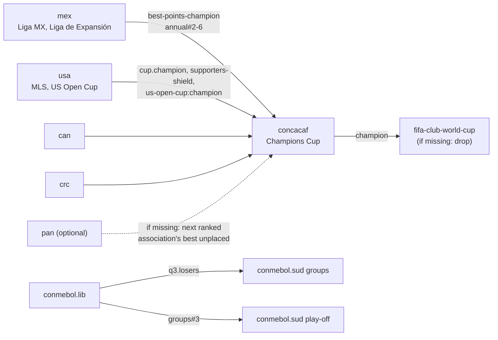

# Modules and rule catalogue for declarative competitions

> **Sintesi (IT).** Come aggiungere o togliere campionati e coppe (nazionali o continentali) come
> *moduli* dichiarativi, e l'elenco completo delle regole che il motore deve avere in partenza, ricavato
> da quelle che il Mod usa nel Mondo 2026-27. Un mondo è un elenco di moduli; i moduli si collegano solo
> attraverso *porte* con un nome (es. `mex.liga-mx:apertura.champion`), così uno si può togliere o
> cambiare senza toccare gli altri. Ogni regola è una *primitiva* con nome, campi JSON, test e testo
> generato; una competizione nuova non richiede codice, solo dati. In fondo: il modulo CONCACAF completo
> come esempio e cosa controlla il validatore.

Status: plan, 2026-10-25. Extends `competition-engine-proposal.md` (the spec model, §4) with the module
system and the full list of rule primitives. Sources for the catalogue: the Mod's
`release/world-2026-27-competitions.md` (every competition of World 2026-27, generated by
`tools/complist.py`), `notes/continental-cups.md`, `notes/CONVENTIONS.md` and the tools named in each row.
The Mod's data and code are summarised here, not copied.

---

## 1. Modules

### 1.1 What a module is

A **module** is a folder that adds competitions (and the clubs they need) to a world. Typical granularity:
one country (`ita/`), one confederation's club cups (`concacaf/`), one special competition
(`fifa-club-world-cup/`).

```
modules/
  mex/
    module.json          # manifest: id, version, provides, requires, licence, sources
    competitions.json    # specs (proposal §4), one or more competitions
    clubs.json           # club ids, names, area, rivals, squad uuids per season
    names.json           # display names, short forms, round names, per language
    fixtures/2026-27/    # optional: real fixture lists / real draws for season 1
    credits.md           # data sources and their licences
```

`clubs.json` points to squads in OpenSWOS's existing team JSON format (`docs/DATA_JSON.md` §4), so the game
loads them with its own loader. A club has a stable id (`club:mex.america`); its squad uuid changes with
every squad version (`docs/TEAM_IDS.md`), so the mapping is per season.

### 1.2 The manifest

```json
{
  "id": "mex",
  "version": "2026.10.1",
  "schema": 1,
  "kind": "country",
  "country": "MEX",
  "confederation": "CONCACAF",
  "provides": {
    "mex.liga-mx:apertura.champion":   "club",
    "mex.liga-mx:clausura.champion":   "club",
    "mex.liga-mx:annual":              "ranking",
    "mex.liga-mx:best-points-champion":"club",
    "mex.liga-expansion:annual":       "ranking"
  },
  "requires": {},
  "licence": "data: see credits.md",
  "sources": ["Liga MX Reglamento de Competencia 2026-27"]
}
```

`provides` lists the module's **ports** (§2): the only things other modules may read. `requires` lists
ports of other modules this one reads (a continental module requires many; a country usually none).

### 1.3 The world manifest

```json
{
  "id": "world-2026-27",
  "start_season": "2026-27",
  "calendar_year_leagues": 2026,
  "modules": ["eng", "ita", "esp", "...", "mex", "usa", "crc", "uefa", "conmebol", "concacaf"],
  "seed": 2026,
  "fallbacks": { "unresolved_port": "error" }
}
```

**Adding** a module = adding its folder and its id to `modules`. **Removing** one = deleting the id. The
validator (§5) then reports every port that is now unresolved; each consumer either declares what happens
to such a place (`if_missing`, §3.9) or the world refuses to load. Nothing is silently dropped.

### 1.4 Overrides

A world may patch a module without editing it (e.g. a historic world that wants 1996 Serie A with 18 clubs):

```json
{ "override": "ita.serie-a", "set": { "participants.count": 18, "outcomes[relegated].positions": "15-18" } }
```

Overrides are validated like specs and listed in the world's generated rule notes.

## 2. Ports

A port is `module.competition:selector`. Selectors:

| Selector | Meaning | Example |
|---|---|---|
| `stage#N` / `stage#N-M` | positions of a stage's ranking | `ita.serie-a:table#1-4` |
| `stage.group#N` | position in a group (`*` = every group) | `ita.serie-c:gironi.*#1` |
| `stage.winner` / `.runner-up` / `.losers` | knockout results | `conmebol.lib:q3.losers` |
| `champion` | the competition's declared champion | `bra.copa-do-brasil:champion` |
| `stage.champion` | a stage's title (Apertura, Clausura) | `arg.lpf:apertura.champion` |
| `next(port)` | best club of a ranking not already placed elsewhere | `next(usa.mls:supporters-shield)` |
| `holder(comp)` | last season's winner of a competition | `holder(concacaf.ccc)` |

Resolution order is declared per consumer (proposal §4.6 `cascade`), and the engine resolves all ports of a
season end in one deterministic pass, in world-module order, then id order.

## 3. Rule catalogue

Each row is one **primitive**: a named rule with JSON fields, a C implementation, unit tests and a
sentence template for `swc-explain`. "Mod" names where the Mod implements it today and a real case from
World 2026-27. Field names follow the proposal's schema.

### 3.1 League structure

| Primitive | JSON | Real case (Mod 2026-27) | Mod source |
|---|---|---|---|
| `round_robin.legs` | `"legs": 1..4` | quadruple round robin: Canada PL (8 clubs, 28 matchdays) and 13 other leagues | game + `split.py` (games) |
| `round_robin.odd_rest` | automatic when n is odd: one club rests per matchday | Malta, Wales, Iceland... ("one club rests each matchday") | `oddtables.py` |
| `table.size_unlimited` | no 24-club limit | Argentina LPF and MLS, 30 clubs | `longtable.py` |
| `groups.parallel` | `"type": "groups", "level_of_pyramid": 3, "allocation": "geographic"` | Serie C 3x20, Serie D 9 groups, El Salvador zones, Primera Nacional 2x18 | `pgroups.py` |
| `groups.geographic_move` | promoted/relegated clubs join the group of their `area` | "promoted and relegated clubs join the group of their area" | `pgroups.py` + clubs `area` |
| `groups.conferences` | groups that only define the table, the calendar crosses them | MLS East/West | `split.py` (stage fixtures) |
| `groups.cross_blocks` | `"cross": k`: clubs in k blocks play only the other blocks | Paranaense, Catarinense | `statespec.py` |
| `points` | `{win, draw, loss}`; `points.shootout_win` for drawn matches decided on penalties | MLS 1997 (win 3, shoot-out win 1, loss 0), see §7 | `mls97.py` |
| `no_movement` | a division with no promotion/relegation | Liga MX ("no promotion or relegation"), 82 lowest divisions | data |

### 3.2 Calendars and fixture constraints

| Primitive | JSON | Real case | Mod source |
|---|---|---|---|
| `schedule.generated` | circle method, `max_run: 3` home/away in a row | every generated league | `oddtables.py` rules |
| `schedule.fixed` | `"fixtures": "fixtures/2026-27/arg-lpf.json"` | Argentina, Apertura/Clausura leagues "on the real fixtures" | `argcal.py`, pack `fixtures` |
| `schedule.mirror` | second tournament = same pairs, home/away reversed | Argentina Clausura | `argcal.reverse` |
| `rivals` | `clubs.json`: `"rival": "club:arg.river"` (pairs, may cross zones) | Boca–River, every LPF club has one | `argcal.py` |
| `constraint.rivals_rest_same_day` | with odd zones, two rivals rest on the same matchday and meet in the interzonal *clásico* | LPF zones of 15 | `argcal.py` |
| `special_matchday` | `{"round": 16, "type": "interzonal", "pairing": "draw", "exclude": "rivals"}` | LPF matchday 16 | `argcal.py` |
| `special_matchday.derbies` | `{"type": "rivals"}`: all rival pairs on one date (derby day) | generic form of the above | — |
| `calendar.window` / `months` | season window and per-stage months | continental rounds: qualifying Aug-Sep, groups Oct-Dec, KO Feb-Apr, final May | `conti` formats |
| `calendar.dates` | real dates mapped to the game's week grid | season 1 of every league | `weeks.py`, packs |
| `league_phase.fixtures` | drawn Swiss-style fixtures (k matches each) | UCL/UEL/UECL 36; Paulista 2026 (8 matches each) | `lp36.py`, `statespec.py` |

### 3.3 Splits and multi-tournament seasons

| Primitive | JSON | Real case | Mod source |
|---|---|---|---|
| `split.after` | `{"after_matchdays": 22, "sections": [...]}` | Scotland, Austria, Greece, Romania, Bulgaria, Ecuador | `split.py` |
| `split.section.legs` | `0` (no more matches), `1..4` | Czech middle group: no more matches | `split.py` |
| `split.points` | `full`, `half_up`, `half_down`, `none` | Greece 5-8 and Romania: halved, rounded up; Albania: rounded down | `split.py` |
| `split.points_among` | points carried = half of those won against the clubs of the same section | Moldova | `split.py` |
| `split.keep_table` | reset points but keep the opening table as a record | Malta (Opening Round table kept) | `split.py` |
| `split.home` | `balance` (hosted the other fewer times), `reverse_nth` (away in their n-th meeting), `seeded` | Scotland/Switzerland/Korea: balance; Northern Ireland: away in the 3rd meeting | `split.py` |
| `tournaments.apertura_clausura` | two `round_robin` stages with `resets: [points, stats]` | Argentina, Paraguay, Honduras, Guatemala, Costa Rica, Panama, Bolivia | `arg97.py`, `argcal.py` |
| `tournament.final_phase` | knockout after each tournament from `stage#1-N` or `group#1-N` | LPF "first 8 of each group", Central America "1st-4th / 1st-6th" | `engine.py` + `gplay.c` |
| `trophy_of_champions` | `single_match` of the two tournament winners, `skip_if: same_club` | Trofeo de Campeones (Argentina) | `gplay.c` |
| `aggregate_table` | `of: [apertura, clausura]` for places and relegation | Argentina annual table | `arg97.py` |
| `average_table` (promedio) | `seasons: 3, metric: points_per_match` | Argentina DESCENSO | Argentina modules |
| `stage_titles` | a stage's winner is a title of its own (honours, access lists) | Apertura / Clausura champions feeding CONMEBOL places | `conti` + `gplay` stage_title |

### 3.4 Tables and tie-breakers

| Primitive | JSON | Real case | Mod source |
|---|---|---|---|
| `tiebreakers` | ordered list (proposal §4.4), recursive head-to-head | every league with its real criteria | `zones.py` / data |
| `tiebreak.faithful_1996` | points, GD, GF, name | the original 1996 world | game |
| `table.legend_zones` | outcome `zone` tags per position, per group | CL / EL / CONF / PROM / P.OFF / P.OUT / RETR, legend above the table | `zones.py` (CONVENTIONS 5-7) |
| `points.adjustment` | `{"club": ..., "points": -N, "reason": ...}` in season-1 data | point deductions where real | data |

### 3.5 Knockout ties

| Primitive | JSON | Real case | Mod source |
|---|---|---|---|
| `decider` | ordered list: `aggregate`, `away_goals`, `extra_time`, `penalties`, `better_placed`, `replay`, `draw_lots`, `golden_goal` | "two legs (aggregate, then penalties, no extra time)", "extra time, then the better placed" | `gplay.c` (CONVENTIONS 10) |
| `decider.one_per_round` | one decider per round, chosen from the list above; never invented per competition | CONVENTIONS 10 | — |
| `home.better_placed` | single match at the better-placed club; two legs: 2nd leg at the better placed | Serie C play-outs, LPF final phases | `gplay.c` |
| `home.real_schedule` | home order as in the real schedule (season 1), then a declared rule | EFL play-offs round 1 | packs |
| `home.drawn` / `home.neutral` | drawn order; neutral ground | "home order drawn"; finals at neutral ground | `gplay.c` |
| `home.better_record` | final hosted by the finalist with the better goal difference in earlier rounds | CONCACAF Champions Cup final | `conti` format |
| `skip_if.points_gap` | tie not played if the clubs are N+ points apart (then the lower is relegated) | Serie C/D play-outs: 8 points | `gplay.c` |
| `skip_if.same_club` | not played if one club is on both sides | Trofeo de Campeones, CPL | `gplay.c` |
| `round_names` | rounds named and numbered as in reality, per language | "rounds numbered as in reality" | `complist.py`, names |

### 3.6 Play-offs and play-outs

| Primitive | JSON | Real case | Mod source |
|---|---|---|---|
| `playoff.purpose` | `promotion`, `title`, `placement`, `continental_place`, `playout` | 19 promotion, 12 play-out, 10 placement, 5 title, 3 European play-offs in World 2026-27 | `engine.py` + `gplay.c` |
| `playoff.entrants_multi` | entrants from several rankings | Bundesliga 16th + 2. Bundesliga 3rd; Serie D champions' poule (9 group winners) | packs |
| `playoff.bracket` | pairs declared by position (`"#3-#6"`), byes for top seeds | Championship play-offs 3rd-8th; Reducido (Argentina) | `gplay.c` |
| `playoff.seeds_from_rounds` | seeds = the season's round rankings | Malta title play-off | `gplay.c` |
| `playoff.loser_out_of_world` | loser goes to the reserve (out of the world) | Serie D play-outs (9 cases) | `ripool.py` |
| `playoff.european_place` | a place that only leads to a play-off is painted P.OFF, not the cup's colour | Austria, Netherlands, Denmark, Bulgaria | `zones.py` (CONVENTIONS 7) |

### 3.7 Pyramid moves

| Primitive | JSON | Real case | Mod source |
|---|---|---|---|
| `outcome.promoted/relegated` | positions + target competition | "2 up; 3 down" (EFL Championship) | game + data |
| `outcome.lowest_division` | "nobody goes down": the world's floor | 82 divisions | data |
| `outcome.via_playoff` | promotion/relegation decided by a play-off stage | Serie B, EFL, LPF Reducido | `engine.py` |
| `pool.off_file` | clubs outside the playable files that can enter/leave (pools) | Eccellenza pool, second pools, state-only clubs | `ripool.py`, `worldpool.py` (CONVENTIONS 13) |

### 3.8 National cups

| Primitive | JSON | Real case | Mod source |
|---|---|---|---|
| `cup.entry_by_round` | per division, the round a club enters | "entering: 1st round 14, quarter-finals 1"; 70 cups with "N byes into the 2nd round" | `cupsf.py`, packs |
| `cup.byes` | byes to reach a power of two | Coppa Italia Serie C: 15 byes into the 2nd round | game + data |
| `cup.season1_real` | season 1 = the clubs still in the real cup and the real first-round pairs; later seasons drawn | 33 + 17 + 10 cups "as really drawn" | `cupsf.py`, `cupd.py` |
| `cup.round_rules` | rules change per round (e.g. two legs only in the semi-final) | EFL Cup: round 3 two legs, final single | data |
| `cup.whole_division` | every club of a level enters | Coppa Italia Serie D (162 clubs) | `cupd.py` |
| `cup.in_game_subset` | the real cup has N clubs, the game plays M from round k | Canadian Championship: 15 real, 8 in the game | `complist.py` |
| `state_championship` | sub-national competitions (groups + knockout) before the national season | Brazil's state championships | `statespec.py`, `statecup.py` |

### 3.9 Continental club cups

| Primitive | JSON | Real case | Mod source |
|---|---|---|---|
| `access_list` | per association: places by league rank, cup winner, `next`, stage titles | CONMEBOL, CONCACAF, AFC, CAF, OFC; UEFA 2026-27 matrix | `conti.c`/`.py`, `uefaq.c` |
| `access.coefficients` | simulated association/club coefficients move places from season 2 | "from season 2: Champions League N ... by the simulated association coefficients" | `uefacoef.py` |
| `access.cascade` | unused places move by a declared rule (holder already qualified, excess beyond top 9) | UEFA places by rank | `uefaq.c` |
| `access.holders` | holders' slots (cup winner -> same cup, Europa League winner -> CL ...); always resolved through §3.12, never applied directly | UCL holder + UEL winner | `uefaq.c` |
| `access.if_missing` | place of an association/cup not in the world -> declared target | CONCACAF "outside" places; Leagues Cup / Central American Cup places to their countries' leagues | `concacaf.access.json` |
| `qualifying_rounds` | champions / league paths, seeded by coefficient | UEFA Q1-Q3 + play-off, Libertadores Q1-Q3 | `uefaq.c`, `conti` |
| `draw.pots` | pots by ranking, `same_assoc: no / allow_if_via`, holder in A1 | Libertadores groups; ACL | `conti` |
| `draw.seeded_bracket` | seeded positions + byes | CONCACAF CC round 1 (5 byes) | `conti` |
| `league_phase` | 36-club Swiss phase, 2 opponents per pot, country protection | UCL/UEL/UECL 2026-27; ACL Elite league stage | `lp36.py` |
| `cross_cup` | a round's losers or a group place go to another cup's stage | Libertadores Q3 losers -> Sudamericana groups; Libertadores group 3rd -> Sudamericana play-off | `conti` (`losers`, `out`) |
| `feeder_cups` | regional cups whose winners enter a bigger cup | Central American Cup / Caribbean Cup -> CONCACAF CC | `concacaf.access.json` (declared, not in world) |
| `guest_clubs` | clubs outside the world's leagues that play only a continental cup (guest squads) | `*.guests.json` for every confederation | `conti`, guests data |
| `season1_entrants` | the real entrants of the first edition | `entrants_season1` in every access file | `conti` |
| `super_cup` | single match / two legs between two cup winners | UEFA Super Cup, Recopa | `conti`, 4.0 Supercup |

### 3.10 Career and world rules

| Primitive | JSON | Real case | Mod source |
|---|---|---|---|
| `visibility.real_only` | a career club plays (and sees in its calendar) only what its real club would; others are simulated for winners and holders | Serie D club: its group + Coppa Italia Serie D (CONVENTIONS 11) | Mod world logic |
| `simulate.world_wide` | every competition the player does not play is simulated each season, so every cup has winner, runner-up, holders, honours | all continental cups | `conti.c`, `simdraw.py` |
| `honours.path` | each club's round reached, for honours and season review | all cups | `conti` |
| `season_naming` | edition named by year (2026-27 plays the 2027 editions) | continental cups | `conti` |

### 3.11 Presentation (generated from the specs)

| Primitive | JSON | Real case | Mod source |
|---|---|---|---|
| `names.lang` | names per language with `short` and a width limit | 35-byte titles, 70-px calendar labels, 4 languages | `titlelegs.py`, `complist.py` (CONVENTIONS) |
| `explain` | FORMAT page and rule notes generated from the spec, per language | FORMAT pages, "Every country, every competition" | `fmtpage.py`, `fmtprose.py`, `complist.py` |
| `zones` | colours + legend from outcome tags | all tables | `zones.py` |

### 3.12 Entitlements, precedence and guarantees

A real bug report on the Mod's 4.0.1 shows why this needs its own primitive. A Milan career: season 2 the
club wins Serie A *and* the Conference League; season 3 it plays the Europa League instead of the Champions
League. The Conference winner's slot (to the Europa League) was applied after, and over, the league
champion's slot. In imperative code the outcome depends on the order in which two pieces of code run; in
the engine it must depend only on declared rules.

**Entitlements, not assignments.** At season end the link resolver first collects, for every club, *all*
the places it is entitled to (league position, cup win, title holder, coefficient place), each as an
entitlement `{club, target competition, stage, source}`. Nothing is assigned yet.

**One declared precedence.** Each confederation module declares the order of its competitions and stages,
from best to worst:

```json
"precedence": [ "uefa.ucl:league-phase", "uefa.ucl:play-off", "uefa.ucl:q3", "uefa.ucl:q2", "uefa.ucl:q1",
                "uefa.uel:league-phase", "uefa.uel:play-off", "uefa.uel:q3",
                "uefa.uecl:league-phase", "uefa.uecl:play-off", "uefa.uecl:q3", "uefa.uecl:q2", "uefa.uecl:q1" ]
```

The resolver gives every club its **best** entitlement by this list. Every other entitlement of that club
becomes a **vacated slot**, filled by the declared `cascade` rule of that slot (next club of the same
league, or the access list's rebalancing, as UEFA's own access list says). The order in which modules,
competitions or code run cannot change the result: the algorithm is "best entitlement wins, then
cascade", applied to the whole set at once, repeated until stable (it always ends: every step moves a club
up the precedence list or fills a slot).

**Guarantees.** A module can state what must always be true, and the engine checks it at every season end:

```json
"guarantees": [
  { "club": "ita.serie-a:champion", "plays": "uefa.ucl", "stage_at_least": "uefa.ucl:league-phase" },
  { "club": "uefa.uecl:champion",   "plays_at_least": "uefa.uel:league-phase" }
]
```

A guarantee is checked three times:

1. by the **validator**, which proves on the declared precedence that no combination of entitlements can
   break it (here: the Serie A champion's entitlement is `ucl:league-phase`, the top of the list, so no
   other entitlement can push it lower);
2. by **property tests** (testing strategy L2), which give random clubs random combinations of titles;
3. at **runtime**: if a guarantee were ever false at a season end, the engine stops with an error that names
   the club, the guarantee and the entitlements involved, instead of producing a wrong season.

So the Milan case becomes a declared rule ("the Serie A champion always plays the Champions League league
phase"), a line in the precedence list, and a scenario (testing strategy L3) that forces the double win.
It can no longer depend on the order of two code paths.

### 3.13 Added after reviewing the Mod's notes and sessions

A pass over the Mod's notes (`release/notes-world-2026-27.md` "Rebuilt exactly", `notes/domestic-schedule.md`,
`notes/sa401-exact-designs.md`, `notes/world-2025-26-split.md`, `internal/world2526/formats2627.md`, the
sessions' handoff files) and over Davide's messages in 53 SWOS sessions added these primitives.

| Primitive | JSON | Real case | Mod source |
|---|---|---|---|
| `club.second_team` | `"second_team_of": "club:ita.juventus"` + per-country rules: `max_level`, `never_into_first_team_level`, `place_passes_to_next`, `forced_down_with_first_team`, `excluded_from: [national_cup]`, `playoffs: allowed/denied` | Juventus Next Gen, Atalanta U23, Inter U23 (up to Serie B, Serie C play-offs allowed); Real Sociedad B; Stuttgart II (never to 2. Bundesliga); Jong PSV; Benfica B; NZ reserves | `formats2627.md` "Second teams" |
| `division.refill` | when a club is forced out (second team, licence), the division keeps its size from a declared pool | Serie C refilled from the Serie D reserve | `ripool.py` |
| `outcome.direct_if_gap` | a play-off place becomes direct if the gap to the next place is > N points | Serie B: 3rd promoted directly if more than 14 points ahead of the 4th; 17th relegated directly if the 16th is more than 4 points ahead | Serie B rules (4.0) |
| `split.points.tiebreak_before_rounding` | after halving, "points before rounding" is the first tie-breaker | Romania, Greece 5-8 | `split.py` |
| `playoff.title_seed` | a title play-off whose bracket depends on who won what: tournament winners A, C and the aggregate top 2; A = C -> no play-off; direct final; semi-finals | Peru Liga 1 national final | `sa401-exact-designs.md` §1 |
| `groups.draw_with_heads` | fixed group heads (1st, 2nd), the rest drawn into the groups without pots; heads at home on the last matchday | Colombia's cuadrangulares | `sa401-exact-designs.md` §2 |
| `constraint.shared_stadium` | clubs sharing a city or stadium never at home on the same day | Colombia (Dimayor) | `sa401-exact-designs.md` §2 |
| `schedule.mirror_infer` | missing second-tournament matchdays inferred as the first tournament's mirror when every published day matches | Peru, Colombia, Uruguay Clausura | `sa_exact.fixtures_full` |
| `series.best_of` | a tie decided over a best-of-N series | MLS Cup play-offs round one (best of three) | `domestic-schedule.md` |
| `second_competition` | a second competition in the same season for the same clubs (regional leagues, then a national championship phase) | New Zealand: Northern/Central/Southern leagues, then the National League Championship and grand final | `domestic-schedule.md` |
| `stage.starts_after` | a stage may start only after another stage (its knockout included) is over | Argentina: the Clausura began while the Apertura play-offs were still running (Davide's report) | `domestic-schedule.md` dates |
| `titles` | every title a competition decides beyond its table (stage champions, play-off winner, trophy of champions, regular season) is an output, listed on a WINNERS view and in honours | Apertura/Clausura champions, Trofeo de Campeones, MLS Cup vs Supporters' Shield, Malta when one club wins both phases | WINNERS page (4.0) |
| `decider.draw_lots` / `golden_goal` / `silver_goal` | historic deciders: lots instead of penalties, golden or silver goal in extra time | World Cup 1934, Mitropa (lots); golden goal kept for later (Davide) | `historic.py`, `mitropa34.py` |
| `decider.required` | every knockout round must declare its decider; there is no default | Copa do Brasil final went to extra time although the real rule is straight to penalties (default inherited from 3.2) | 4.0.1 known issue |
| `calendar.no_phantom_replays` | replay dates exist only if the round's decider contains `replay` | play-offs that are single matches showed replay dates (Davide 21/10) | `gplay.c` fix |
| `cup.entrants_from_current_divisions` | a cup's entrants are recomputed every season from the divisions as they are, with the real byes per division | Mestre promoted to Serie C played no Coppa Italia Serie C; Siracusa's Coppa Italia never started after promotion | 4.0.1 `cupsfollow` |
| `no_cup` | a country module may declare that no national cup is played | Mexico, Honduras, Guatemala, Panama 2026-27 | data |
| `edition_format` | a competition's format can change by season (`valid_from`, `valid_to`), so a historic world plays each year's real format | Champions League format changed in 1997-98; Copa Libertadores 1996 had 5 groups | Davide's requests; `lib97.py` |
| `holder.policy` | era-specific holder rules: holder plays in addition, holder replaces the country's lowest place, holder's place taken from another association | 1984-85: the holder plays in addition; 1996-97 Libertadores holder in its country's group in place of the 2nd | `careerworld.py`, `sacups.py` |
| `approximation.declared` | when the engine or the data cannot be exact, the spec says so in a field, and the text goes into the release notes and the FORMAT page | "Declared: the Paulista's round order is rebuilt"; CONCACAF away goals then penalties | CONVENTIONS 9, 12 |
| `world.min_structure` | a world may require at least the original game's structure (no fewer leagues or divisions than SWOS 96/97) | England's four divisions in World 2026-27 | memory "never fewer divisions" |
| `names.press_style` | club and competition names as the press writes them, without legal suffixes or sponsors | "Parma", not "Parma Calcio"; "COPPA ITALIA" without sponsor | Davide 19/10 |
| `display.stage_in_title` | tables and results show the competition with its stage ("LIGA P. - APERTURA") and explain resets | Argentina | Davide 19/10 |

## 4. Example: the CONCACAF module

Built from the Mod's CONCACAF data (`internal/conti/concacaf.*.json`, private), re-expressed in the
proposed schema. The 2026 Champions Cup shape: 27 clubs, 22 in round 1 and 5 byes into the round of 16,
two legs with away goals then penalties, single final at the finalist with the better goal difference.

`modules/concacaf/module.json`

```json
{
  "id": "concacaf", "version": "2026.10.1", "schema": 1, "kind": "confederation",
  "provides": { "concacaf.ccc:champion": "club", "concacaf.ccc:final.runner-up": "club" },
  "requires": {
    "mex.liga-mx:best-points-champion": "club", "mex.liga-mx:annual": "ranking",
    "usa.mls:cup.champion": "club", "usa.mls:supporters-shield": "ranking", "usa.us-open-cup:champion": "club",
    "can.cpl:annual": "ranking", "can.canadian-championship:champion": "club",
    "crc.primera:annual": "ranking"
  },
  "optional": [ "gua.liga-nacional:champion", "hon.liga-nacional:champion", "pan.lpf:champion",
                "slv.primera:champion", "sur.topklasse:champion" ]
}
```

`modules/concacaf/competitions.json` (extract)

```json
{
  "id": "concacaf.ccc",
  "kind": "continental",
  "names": { "en": "CONCACAF Champions Cup", "it": "CONCACAF Champions Cup", "short": "CONCACAF CHAMP." },
  "edition_naming": "next_year",
  "participants": { "count": 27, "source": "access_list" },
  "access_list": {
    "mex": [ ["r16", "mex.liga-mx:best-points-champion"], ["r1", "mex.liga-mx:annual#2-6"] ],
    "usa": [ ["r16", "usa.mls:cup.champion"], ["r16", "next(usa.mls:supporters-shield)"],
             ["r1", "usa.mls:supporters-shield#1-5"], ["r1", "usa.us-open-cup:champion"],
             ["r1", "next(usa.mls:supporters-shield)"] ],
    "can": [ ["r1", "can.cpl:annual#1-2"], ["r1", "can.canadian-championship:champion"] ],
    "crc": [ ["r16", "crc.primera:annual#1"], ["r1", "crc.primera:annual#2"] ],
    "gua": [ ["r1", "gua.liga-nacional:champion"] ],
    "hon": [ ["r1", "hon.liga-nacional:champion"] ],
    "pan": [ ["r1", "pan.lpf:champion"] ],
    "slv": [ ["r1", "slv.primera:champion"] ],
    "sur": [ ["r1", "sur.topklasse:champion"] ],
    "cascade": "next_in_league",
    "if_missing": { "default": "next_ranked_association_best_unplaced" },
    "guests": "guests.json"
  },
  "stages": [
    { "id": "r1", "type": "knockout", "month": 2,
      "pairing": { "method": "seeded_bracket", "pots_by": "concacaf_club_ranking" },
      "rounds": [ { "legs": 2, "home": "better_placed_second_leg", "decider": ["aggregate", "away_goals", "penalties"] } ] },
    { "id": "ko", "type": "knockout", "entrants": ["byes:r16", "r1.winners"], "pairing": "bracket",
      "rounds": [
        { "name": "round-of-16",    "month": 3, "legs": 2, "home": "better_placed_second_leg", "decider": ["aggregate", "away_goals", "penalties"] },
        { "name": "quarter-finals", "month": 4, "legs": 2, "home": "better_placed_second_leg", "decider": ["aggregate", "away_goals", "penalties"] },
        { "name": "semi-finals",    "month": 4, "legs": 2, "home": "better_placed_second_leg", "decider": ["aggregate", "away_goals", "penalties"] },
        { "name": "final",          "month": 5, "legs": 1, "home": "better_record:goal_difference", "decider": ["extra_time", "penalties"] } ] }
  ],
  "outcomes": [ { "from": "ko", "positions": 1, "tag": "champion",
                  "to": "fifa.club-world-cup", "if_missing": "drop" } ],
  "season1": { "entrants": "fixtures/2027/entrants.json" }
}
```



What changes when modules come and go:

- **Remove `pan`**: its port is in `optional`, so its place follows `if_missing` (the next ranked
  association's best unplaced club). The validator lists the move in the world's rule notes.
- **Remove `usa`**: its ports are in `requires`, so the world refuses to load until the world either drops
  `concacaf` or overrides its access list. That is deliberate: a CONCACAF without the MLS is a design
  decision, not an accident.
- **Add `jam`** (Jamaica): add the module and one access row (an override in the world, or a new version of
  `concacaf`). No code.

## 5. The validator

`swc-validate world.json` checks, in this order:

1. **Schema**: every module's JSON against the schema version it declares.
2. **Ports**: every `requires` resolved; every `optional` either resolved or covered by `if_missing`;
   no two modules provide the same port.
3. **Counts**: entrants of each stage = the stage's size (with byes); access lists fill the declared
   `participants.count` in the *worst* case (after cascades and fallbacks).
4. **Pyramid**: each promotion has a matching relegation slot one level up/down (per area for parallel
   groups), and the lowest division declares `lowest_division`.
5. **Calendar**: every stage fits its months; no club needs two matches in one week (the bug class the
   Mod met with odd tables and career calendars).
6. **Draws**: every constrained draw is satisfiable for the season-1 entrants and for a sample of
   generated seasons.
7. **Texts**: names in every declared language, within width limits, only characters the game's font has.
8. **Simulation smoke test**: three seasons with the stub provider, no unresolved state, no club in two
   divisions, golden file written for review.

## 6. How the code follows (almost automatically)

- **A registry of primitives.** Each primitive is one entry: schema fragment, C function(s), unit tests,
  explain templates in each language. The schema and its reference documentation are generated from the
  registry, so the docs cannot drift from the code.
- **Adding a competition never adds code.** It adds a module; CI validates and simulates it.
- **Adding a rule** (rare) is one PR: registry entry + implementation + tests + templates, reviewed on its
  own (`ai-development-guidelines.md`). The catalogue above is the target set for version 1, so World
  2026-27 needs no new rule after it.
- **Importers** turn the Mod's existing data into modules: `pack.json` leagues/splits/parallel groups,
  `statespec` state championships, `conti` formats and access lists, `cupsf` real cup brackets. The Mod's
  `complist.py` output for World 2026-27 becomes the acceptance test: `swc-explain` must say the same thing
  for every competition.
- **Scaffolding**: `swc new country mex --levels 2 --cup`, `swc new confederation concacaf` write a module
  skeleton with placeholders and a failing validation that lists what to fill.

## 7. Open points

1. **Shoot-out points** (the Mod's MLS 1997 season: win 3, shoot-out win 1, loss 0): kept as
   `points.shootout_win` for historic worlds; check which other Mod seasons use it (NZ, Africa packs mention shoot-outs) before version 1.
2. **Replays** (historic FA Cup): `decider: replay` needs calendar slots; only historic worlds.
3. **Coefficients across worlds**: a world without some associations computes rankings only from the
   modules present; declare whether frozen real rankings may be used instead (the Mod froze 2025 for 4.0).
4. **Guest clubs** for continental cups: same squad format, but whether they can be signed in transfers is a
   career rule to decide (the Mod's CONVENTIONS 13 says off-file clubs must never trap any path).
5. **Granularity of modules**: one per country is natural; a world might want "Italy without Serie D"
   (an override removing a level) — the pyramid check must then accept a floor above Serie D.
