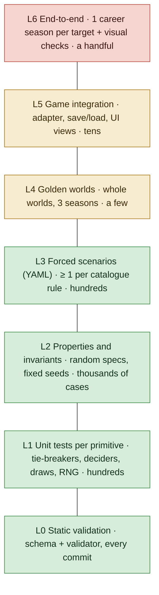

# Testing strategy for the competition engine

> **Sintesi (IT).** Oggi il Mod verifica quasi tutto con test end-to-end: il gioco vero in DOSBox-X, una
> suite da circa 12 minuti più una carriera da 20 stagioni, perché la logica è dentro l'exe. Con un motore
> separato dal gioco la piramide si rovescia: quasi tutto si verifica in millisecondi con test sulle singole
> regole, test di proprietà e scenari "forzati" scritti in YAML leggibile, più pochi golden file di mondi
> interi. I test end-to-end restano pochissimi: una stagione di carriera per target e i controlli visivi.
> Ogni bug diventa un test al livello più basso possibile, mai un nuovo test end-to-end.

Status: plan, 2026-10-25. Companion of `competition-engine-proposal.md` §6 (determinism and golden files)
and `rule-catalogue.md` (the primitives to test).

---

## 1. Why the pyramid changes

In the Mod every format rule lives inside the 1996 executable, so the only way to see it work is to run the
game: `tools/swostest.py` plays it in DOSBox-X with a key feeder and memory reads. That harness is good and
it found real traps, but it is slow (the full suite takes about 12 minutes on four DOSBox slots, the
20-season career much longer), it needs forcing tricks (pokes, `*_FORCE` build switches) to reach rare
cases, and a failure points at a memory address rather than at a rule.

With the engine separated from the game (proposal §3), a rule is a C function with inputs and outputs. It
can be tested directly, so tests move down the pyramid:



The target share, by number of tests: L0-L3 about 95 %, L4-L5 about 5 %, L6 a handful. By run time: the
whole L0-L5 set under one minute on a laptop, so it runs on every commit; L6 runs before a release.

## 2. The levels

### L0 — Static validation

`swc-validate` (rule catalogue §5) on every module of every world in the repository: schema, ports, counts,
pyramid, calendar fit, draw satisfiability, name widths and characters. Most mistakes in data never reach a
simulation. Each validator check has its own tests: a broken example module that must be rejected with the
expected message.

### L1 — Unit tests per primitive

Each registry entry (rule catalogue §6) ships table-driven unit tests in C. Examples:

| Primitive | Typical cases |
|---|---|
| `tiebreakers` | three clubs level on points, head-to-head decides two of them, then goal difference the third (recursive mini-table) |
| `decider` | 1-0 / 0-1 with `away_goals` off -> extra time; 2-1 / 1-0 with away goals on -> away side through |
| `split.points` | 35 points `half_up` -> 18, `half_down` -> 17; Moldova `points_among` |
| `average_table` | promedio compared by cross-multiplication: 1.333... vs 4/3 exactly equal -> next criterion |
| `draw.pots` + constraints | 36 clubs, 4 pots, no same-association pair -> solution found; impossible set -> `unsatisfiable` |
| RNG | known-answer vectors: seed 42, purpose "x" -> first 16 outputs fixed forever |

Unit tests use no files and no game; they run in microseconds and on every target, including the Amiga
build (big-endian, 32-bit), which catches byte-order and width bugs early.

### L2 — Properties and invariants

Random but valid specs (generated within the schema) and random results, over a fixed list of seeds so
that any failure is reproducible. Invariants that must always hold:

- every pair meets exactly `legs` times in a round robin; no club plays twice in one matchday; with an odd
  number of clubs each club rests the same number of times (the odd-table bug of the original game would
  fail here at once);
- points = win × wins + draw × draws (+ declared adjustments); goals for = goals against over a table;
- each promotion slot has a matching relegation slot; no club ends in two divisions or in none;
- every knockout tie produces exactly one winner; byes + entrants = bracket size;
- every constrained draw satisfies its constraints;
- every club gets its **best** entitlement by the declared precedence, and every declared guarantee holds
  (rule catalogue §3.12): random clubs win random combinations of league, cup and continental titles;
- **determinism**: running the same input twice gives byte-identical output; adding an unrelated module
  does not change any other competition's draws (RNG substreams, proposal §6).

A failing random case is shrunk to a minimal spec and saved as a regression scenario (L3).

### L3 — Forced scenarios

The level that replaces most of today's end-to-end runs. A scenario is a small YAML file: a spec fragment
(or a reference to a module), a **scripted result provider** that forces the exact results the case needs,
and the expected outcome. No re-running in the hope of a case: the result is forced, as the Mod's
CONVENTIONS 15 already requires.

```yaml
# scenarios/ita/serie-c-playout-gap.yaml
name: Serie C play-out not played when the gap is 8 points or more
uses: modules/ita#ita.serie-c
force:
  table: { gironi.A: { "#16": { points: 40 }, "#19": { points: 31 } } }
expect:
  - playout.A.tie("#16-#19"): not_played
  - relegated: [ "gironi.A#19" ]
  - zones: { "gironi.A#19": RETR }
```

```yaml
# scenarios/conmebol/q3-losers-to-sudamericana.yaml
name: Libertadores Q3 losers enter the Sudamericana group stage
uses: [modules/conmebol, modules/arg, modules/bra]
force:
  results: { conmebol.lib.q3: { tie1: [ [1, 0], [0, 2] ] } }    # first leg 1-0, second leg 0-2
expect:
  - conmebol.lib.q3.tie1.winner: away_side
  - conmebol.sud.groups.entrants contains: conmebol.lib.q3.tie1.loser
```

```yaml
# scenarios/uefa/league-champion-beats-uecl-winner.yaml
# From a player's report on Mod 4.0.1: Milan won Serie A and the Conference League,
# then played the Europa League. The league title must always mean Champions League.
name: Serie A champion who also wins the Conference League plays the Champions League
uses: [modules/uefa, modules/ita]
force:
  champion: { ita.serie-a: club:ita.milan, uefa.uecl: club:ita.milan }
expect:
  - next_season.uefa.ucl.league-phase contains: club:ita.milan
  - next_season.uefa.uel.entrants not contains: club:ita.milan
  - vacated: { "uefa.uel:league-phase (uecl winner)": filled_by_cascade }
```

Rules for scenarios:

- every primitive of the catalogue has at least one scenario; the registry check fails if one is missing;
- every bug reported by a player becomes a scenario at the lowest level that reproduces it, never a new
  end-to-end test (this changes the Mod's CONVENTIONS 16, which asks for a harness scenario per bug);
- scenarios are plain text a non-programmer can read and write: Davide can add one for a format he knows.

### L4 — Golden worlds

A few whole worlds simulated headless with the stub provider (proposal §6): World 2026-27 for three seasons,
the 1996 world, one historic world. The output (every table, bracket, draw, link resolution, honours) is a
JSON file compared with the committed golden file. A diff must be explained in the commit that causes it.
Golden worlds catch interactions between modules that scenarios do not cover (cascades of continental
places, cross-cup moves, pyramid moves over several seasons).

A special golden test proves the **1996 equivalence**: the faithful OpenSWOS code path and the engine, same
seed and same results, must produce the same season (differential testing, migration plan phase 2).

### L5 — Game integration

Tests of the adapter between OpenSWOS and the engine, run by the game binary in a headless mode, following
the pattern the project already uses for `--custom-team-selftest` and `--dos-sound-selftest` (proposal:
`--comp-selftest`):

- a season driven through the real career code with simulated matches, checking that every event the
  engine emits is consumed and every result submitted;
- save in the middle of each stage type, load, continue: the outcome equals an uninterrupted run;
- the UI views (table, fixtures, bracket, zones) render from engine data without missing fields;
- old save versions load through the declared migrations.

### L6 — End-to-end, kept small

- One career season per target (SDL x86_64, Amiga under the AmigaScope harness), menus driven by injected
  input, with the testers' `no_injuries_cards` setting so VIEW RESULT runs through the season without
  prompts, and the autoskip menu trace (`make SWOS_DEBUG=1`) as diagnostics: proves the whole chain starts,
  saves and ends a season.
- Visual checks of new screens (a table with zones, a bracket, a FORMAT page), reviewed by a person, as the
  Mod's visual tour before every release candidate.
- Nothing else. A rule that can only be checked end-to-end is a sign the rule leaked into the game code.

## 3. What this means for the Mod's habits

| Today in the Mod | With the engine |
|---|---|
| a new feature gets a DOSBox harness scenario | a new rule gets unit tests + a YAML scenario; a new competition gets validation + a golden world update |
| result-dependent cases forced with pokes and `*_FORCE` build switches | forced by the scripted result provider; no special builds |
| 20-season career before a release | a 20-season golden world headless (seconds), plus the L6 season per target |
| bisect a failure by re-running scenarios alone in DOSBox | the failing scenario names the rule; the golden diff names the competition and the season |
| suite ~12 min on 4 DOSBox slots | L0-L5 under a minute on every commit |

## 4. Tooling and CI

- **Hermetic tests**: each test builds its own world from files; no cache or state is shared between tests
  (the Mod's serial harness runs once produced false regressions through shared module caches).
- **Shipped data**: golden worlds and L5 run on the data packs that are actually released, never only on test
  fixtures (the Mod's CONVENTIONS 17a: a crash existed only in release builds).

- `swc-test` runs L0-L4 (C unit tests through a small test runner, scenarios and golden worlds through
  `swc-sim`); `make test` in OpenSWOS adds L5.
- CI matrix: SDL x86_64 and arm64 for every commit; the Amiga build for unit tests and L5 nightly (the
  stricter target, as `.claude/CLAUDE.md` says).
- Coverage is measured per primitive, not per line: the registry lists each primitive's unit tests and
  scenarios, and CI fails if a primitive has none.
- Test data lives with the module that needs it (`modules/ita/scenarios/`), so removing a module removes its
  scenarios, and adding one brings its own.

## 5. First steps

1. Phase 0 of the migration plan is itself a test: a golden season for the current OpenSWOS, before any
   engine code exists.
2. The RNG known-answer vectors and the scenario file format are defined before the first primitive.
3. The first primitives (round robin, tie-breakers, knockout deciders) arrive with L1 + L2 + L3 tests in the
   same PR; the 1996 English pyramid golden comes with phase 2.
